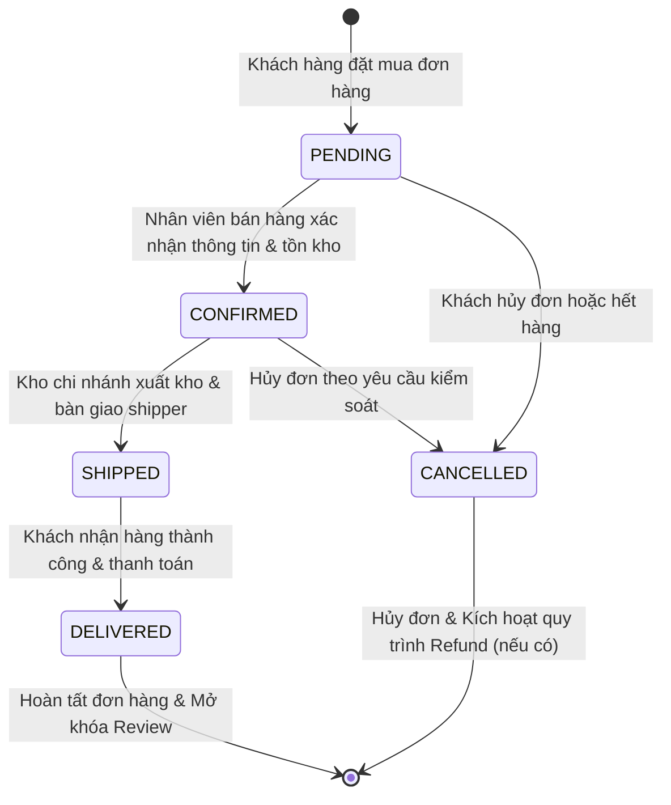

# BÁCH KHOA TOÀN THƯ KỸ THUẬT HỆ THỐNG QUẢN TRỊ ECOMFLOW ADMIN
> **EcomFlow Admin Technical Product & Architecture Specification**  
> *Tài liệu kỹ thuật toàn diện về Kiến trúc hệ thống, Cơ sở dữ liệu 16 bảng, Quy tắc nghiệp vụ, Danh mục API và Ánh xạ Giao diện.*

---

## 1. TỔNG QUAN SẢN PHẨM & KIẾN TRÚC HỆ THỐNG

### 1.1 Bối cảnh & Bài toán nghiệp vụ
**EcomFlow Admin** là nền tảng phần mềm quản trị chuỗi bán lẻ đa kênh kết hợp thương mại điện tử quy mô lớn (Omnichannel Retail & E-Commerce ERP). Hệ thống được thiết kế để giải quyết bài toán vận hành phức tạp của chuỗi bán lẻ hiện đại bao gồm:
1. **Quản trị danh mục hàng hóa tập trung:** Định danh và chuẩn hóa 712 sản phẩm gốc thuộc 8 ngành hàng và 61 thương hiệu, đồng bộ toàn bộ thông số vật lý phục vụ tính toán logistics.
2. **Điều phối tồn kho thời gian thực:** Quản trị ma trận phân bổ kho hàng trên mạng lưới 51 showroom / chi nhánh trên cả nước với 28.990 cặp quan hệ (Subsidiary - Product), tự động kích hoạt cảnh báo khi tồn kho chạm ngưỡng an toàn.
3. **Quản lý vòng đời đơn hàng & Đối soát tài chính 1:1:** Xử lý luồng đơn hàng từ khi tạo giỏ, đặt hàng, phân công nhân viên xử lý, điều phối chi nhánh xuất kho đến khi đối soát giao dịch thanh toán độc lập với các cổng VNPAY, MOMO, ZALOPAY, BANKING, COD.
4. **Vận hành chiến dịch khuyến mãi động:** Thiết lập và quản lý 80 chương trình ưu đãi, gán sản phẩm vào chương trình giảm giá và tự động tính toán đơn giá bán cuối cùng.
5. **Chăm sóc khách hàng thông minh (CSKH NLP):** Phân tích sắc thái cảm xúc tự động (Positive, Neutral, Negative) từ 5.459 đánh giá thực tế của người dùng thông qua 8 cờ nhị phân, hỗ trợ nhân viên phản hồi trực tiếp.

### 1.2 Nhóm đối tượng người dùng (User Personas)
* **Executive Board (Ban giám đốc / Giám đốc điều hành):** Theo dõi các chỉ số KPI thời gian thực (doanh thu thực thu, lượng đơn hàng, khách hàng hoạt động, tỷ lệ hoàn thành đơn, xu hướng doanh số theo từng chi nhánh).
* **Supply Chain & Inventory Manager (Quản lý kho vận):** Theo dõi số lượng tồn kho từng chi nhánh, cảnh báo chạm đáy kho (< 5 sản phẩm), thực hiện nghiệp vụ nhập kho (+) / xuất kho (-) và điều chuyển nội bộ.
* **Sales & Operations Admin (Vận hành đơn hàng):** Theo dõi trạng thái đơn hàng, phân công nhân sự vận chuyển, xử lý giao hàng thành công hoặc hủy đơn.
* **Finance & Accounting (Bộ phận kế toán / Tài chính):** Kiểm tra đối soát 1:1 giữa hóa đơn mua hàng (`orders`) và biên lai thanh toán (`payments`), xử lý hoàn tiền (`refund_at`).
* **Marketing & Merchandising Specialist (Chuyên viên khuyến mãi):** Thiết lập chiến dịch giảm giá, điều kiện giá trị đơn tối thiểu (`min_ordervalue`) và gán danh mục sản phẩm áp dụng.
* **Customer Support & Service Lead (Bộ phận CSKH):** Quản lý trạng thái tài khoản khách hàng (`is_active`), kiểm tra giỏ hàng tồn đọng (`carts`) và phản hồi các đánh giá tiêu cực / trung lập của khách hàng.

---

### 1.3 Ngăn xếp công nghệ thực tế (Tech Stack Specification)

| Tầng kiến trúc | Công nghệ sử dụng | Phiên bản / Cấu hình | Vai trò & Trách nhiệm |
| :--- | :--- | :--- | :--- |
| **Database** | Microsoft SQL Server | 2022 / 2025 (`ecomflow_db`) | Lưu trữ 16 bảng dữ liệu sạch với 66.679 bản ghi thực tế, hỗ trợ khóa chính, khóa ngoại, ràng buộc toàn vẹn |
| **Port CSDL** | TCP/IP Port | `1433` (hoặc SQLEXPRESS instance) | Cổng giao tiếp mạng TDS giữa Backend Java và CSDL SQL Server |
| **Backend Runtime** | Java OpenJDK | 21 (LTS) | Nền tảng thực thi backend hiệu năng cao, tối ưu hóa bộ nhớ và garbage collection |
| **Framework lõi** | Spring Boot | 3.3.4 | Nền tảng vi dịch vụ cung cấp dependency injection, auto-configuration và lifecycle management |
| **ORM / Data Access** | Spring Data JPA / Hibernate | 6.5.3.Final | Ánh xạ Domain Entities, xử lý truy vấn động, chống lỗi N+1 Query bằng `JOIN FETCH` |
| **Connection Pool** | HikariCP | 5.1.0 | Quản lý kết nối JDBC hiệu năng cao, cơ chế tự động reconnect và timeout |
| **Validation** | Jakarta Bean Validation | Hibernate Validator | Ràng buộc dữ liệu đầu vào tại Controller (`@Valid`, `@NotBlank`, `@Min`, `@DecimalMin`) |
| **Tiện ích Java** | Project Lombok | 1.18.x | Giảm tải boilerplate code (`@Getter`, `@Setter`, `@Builder`, `@RequiredArgsConstructor`) |
| **Frontend UI** | HTML5, CSS3, ES6+ | Vanilla Modern JavaScript | Giao diện Single-Page Dashboard trực quan, tương thích đa thiết bị |
| **UI Framework** | Bootstrap 5 | 5.3.3 & Bootstrap Icons 1.11.3 | Hệ thống lưới (Grid system), Modal, Offcanvas Drawer, Toast Notification |
| **Data Visualization** | Chart.js | 4.4.2 CDN | Biểu đồ đường (Line), cột ngang (Bar), và tròn khuyết (Doughnut) phân tích dữ liệu |
| **Design System** | Red & White Theme | Custom CSS Variables | Tông màu chủ đạo Crimson Red (`#D90429`), Ruby Red (`#DC2626`), nền Trắng xám (`#F8FAFC`) |
| **Cổng Backend** | Embedded Apache Tomcat | `8080` (Context path: `/`) | Phục vụ RESTful API (`/api/v1/...`) và static files (`/index.html`) |
| **Cổng Live Server** | VS Code Live Server | `5500` (`http://127.0.0.1:5500`) | Máy chủ tĩnh cho môi trường phát triển UI độc lập (hỗ trợ CORS toàn cục) |

---

### 1.4 Sơ đồ kiến trúc phân tầng & Luồng dữ liệu (Mermaid Flowchart)

```mermaid
flowchart TD
    subgraph ClientLayer ["1. CLIENT / PRESENTATION LAYER"]
        BrowserUI["Web Browser (Admin User)"]
        LiveServer["VS Code Live Server (Port: 5500)"]
        StaticResource["Spring Boot Static Assets (Port: 8080)"]
    end

    subgraph DualModeLogic ["DUAL-MODE DATA RESOLUTION (app.js)"]
        AutoDetect{"Kiểm tra Backend:8080 /api/v1/dashboard/kpis"}
        LiveConnected["Chế độ LIVE API: Đọc 100% dữ liệu thực từ CSDL"]
        MockFallback["Chế độ MOCK FALLBACK: Sử dụng EcomMockData dự phòng"]
    end

    subgraph BackendLayer ["2. SPRING BOOT 3.x BACKEND LAYER (Port: 8080)"]
        CORSFilter["CORS Configuration (* Origin Pattern)"]
        GlobalException["GlobalExceptionHandler (@RestControllerAdvice)"]
        
        subgraph Controllers ["RestControllers (/api/v1)"]
            DashCtrl["DashboardController"]
            CatCtrl["CatalogController"]
            InvCtrl["InventoryController"]
            OrdCtrl["OrderController"]
            ProCtrl["PromotionController"]
            CusCtrl["CustomerController"]
            RevCtrl["ReviewAndStaffController"]
        end

        subgraph ServiceLayer ["Service Layer (OOP & @Transactional)"]
            DashServ["DashboardService"]
            CatServ["CatalogService"]
            InvServ["InventoryService"]
            OrdServ["OrderService"]
            ProServ["PromotionService"]
            CusServ["CustomerService"]
            RevServ["ReviewAndStaffService"]
        end

        subgraph Repositories ["Spring Data JPA Repositories (16 Interfaces)"]
            Repo16["16 JPA Repositories (JOIN FETCH & JPQL Aggregations)"]
        end
    end

    subgraph DatabaseLayer ["3. DATABASE STORAGE LAYER (Port: 1433)"]
        HikariPool["HikariCP Connection Pool"]
        MSSQL["Microsoft SQL Server 2025 (Database: ecomflow_db)"]
        
        subgraph Tables16 ["16 Tables (66,679 Records)"]
            T_Brands["dbo.brands (61)"]
            T_Categories["dbo.categories (8)"]
            T_Subsidiaries["dbo.subsidiaries (51)"]
            T_Employees["dbo.employees (409)"]
            T_Products["dbo.products (712)"]
            T_ProductScores["dbo.product_scores (712)"]
            T_ProgramSales["dbo.program_sales (80)"]
            T_ProductSales["dbo.product_sales (4,356)"]
            T_SubProducts["dbo.sub_products (28,990)"]
            T_Customers["dbo.customers (2,402)"]
            T_Carts["dbo.carts (2,292)"]
            T_CartItems["dbo.cart_items (8,259)"]
            T_Orders["dbo.orders (3,212)"]
            T_OrderItems["dbo.order_items (6,464)"]
            T_Payments["dbo.payments (3,212)"]
            T_Reviews["dbo.reviews (5,459)"]
        end
    end

    BrowserUI --> LiveServer
    BrowserUI --> StaticResource
    LiveServer --> AutoDetect
    StaticResource --> AutoDetect

    AutoDetect -- "Phản hồi HTTP 200 OK" --> LiveConnected
    AutoDetect -- "Lỗi mạng / Timeout" --> MockFallback

    LiveConnected --> CORSFilter
    CORSFilter --> Controllers
    Controllers --> ServiceLayer
    ServiceLayer --> Repositories
    Repositories --> HikariPool
    HikariPool --> MSSQL
    MSSQL --> Tables16

    GlobalException -.-> "Bắt lỗi tập trung (400, 404, 500)" .-> Controllers
```

### 1.5 Cơ chế vận hành kép (Dual-Mode Auto-Sync Engine)
Hệ thống Frontend được trang bị một cơ chế điều phối dữ liệu thông minh (**Auto-Sync Dual-Mode**):
* **Khi Backend Online (`http://localhost:8080` đang chạy và kết nối được SQL Server):**
  1. Trình duyệt tự động gửi lệnh thăm dò `fetch('http://localhost:8080/api/v1/dashboard/kpis')` với bộ đếm timeout 2.500ms.
  2. Ngay khi nhận được `success: true`, cờ trạng thái `AppState.isLiveApi` được kích hoạt thành `true`.
  3. Thanh Header hiển thị badge xanh lá: `Live DB: SQL Server 2025 (ecomflow_db)`.
  4. Hệ thống đồng bộ danh mục Lookup (`categories`, `brands`, `subsidiaries`) từ Backend và chuyển đổi toàn bộ 7 phân hệ giao diện sang cơ chế gọi API trực tiếp với phân trang (`page`, `size`) và lọc động (`keyword`, `status`).
* **Khi Backend Offline (Chỉ mở giao diện tĩnh qua VS Code Live Server cổng 5500):**
  1. Yêu cầu thăm dò thất bại (Connection Refused hoặc Timeout).
  2. Cờ `AppState.isLiveApi` giữ giá trị `false`.
  3. Header hiển thị badge vàng cảnh báo: `Mock Data (Cổng 8080 Offline)` kèm Banner hướng dẫn dòng lệnh khởi động `.\mvnw.cmd spring-boot:run`.
  4. Toàn bộ logic giao diện tự động ánh xạ vào đối tượng dữ liệu giả lập dự phòng chuẩn cấu trúc `EcomMockData` tại [js/mock-data.js](file:///c:/Users/Admin/Java-Ecommerce/js/mock-data.js), đảm bảo không bao giờ xảy ra tình trạng sập trang (White Screen of Death).

---

## 2. BÁCH KHOA CƠ SỞ DỮ LIỆU (DATABASE ENCYCLOPEDIA)

### 2.1 Sơ đồ Thực thể Liên kết (Mermaid `erDiagram`)
Toàn bộ 16 bảng và mối quan hệ ràng buộc khóa ngoại (Foreign Keys) được mô hình hóa chính xác 100% theo mã nguồn thực tế:

```mermaid
erDiagram
    BRANDS ||--o{ PRODUCTS : "brand_id"
    CATEGORIES ||--o{ PRODUCTS : "category_id"
    PRODUCTS ||--|| PRODUCT_SCORES : "product_id (1:1)"
    PRODUCTS ||--o{ PRODUCT_SALES : "product_id"
    PROGRAM_SALES ||--o{ PRODUCT_SALES : "sale_id"
    SUBSIDIARIES ||--o{ SUB_PRODUCTS : "subsidiary_id"
    PRODUCTS ||--o{ SUB_PRODUCTS : "product_id"
    SUBSIDIARIES ||--o{ EMPLOYEES : "subsidiary_id"
    CUSTOMERS ||--o{ CARTS : "acc_id"
    CARTS ||--o{ CART_ITEMS : "cart_id"
    PRODUCTS ||--o{ CART_ITEMS : "product_id"
    CUSTOMERS ||--o{ ORDERS : "acc_id"
    EMPLOYEES ||--o{ ORDERS : "employee_id"
    ORDERS ||--o{ ORDER_ITEMS : "order_id"
    PRODUCTS ||--o{ ORDER_ITEMS : "product_id"
    SUBSIDIARIES ||--o{ ORDER_ITEMS : "subsidiary_id"
    PROGRAM_SALES ||--o{ ORDER_ITEMS : "sale_id"
    ORDERS ||--|| PAYMENTS : "order_id (1:1)"
    ORDERS ||--o{ REVIEWS : "order_id"
    PRODUCTS ||--o{ REVIEWS : "product_id"

    BRANDS {
        string brand_id PK
        string brand_name
        string brand_country
        string created_at
        string updated_at
        string ingestion_time
    }

    CATEGORIES {
        string cate_id PK
        string cate_name
        string created_at
        string updated_at
        string ingestion_time
    }

    SUBSIDIARIES {
        string sub_id PK
        string sub_name
        string phone_number
        string establishment_date
        string sub_street
        string sub_district
        string sub_city
        string created_at
        string updated_at
        string ingestion_time
    }

    EMPLOYEES {
        string employee_id PK
        string last_name
        string first_name
        string gender
        string phone
        string email
        string born
        string address
        string recruited_at
        string username
        string password
        string role
        string subsidiary_id FK
        string ingestion_time
    }

    PRODUCTS {
        string product_id PK
        string product_version
        string brand_id FK
        string category_id FK
        string product_name
        string product_description
        string product_status
        decimal product_rating
        int review_count
        decimal product_listprice
        float product_weight_g
        float product_length_cm
        float product_height_cm
        float product_width_cm
        float product_volume_cm3
        float product_density_g_cm3
        string product_photos_link
        int product_photos_qty
        string created_at
        string updated_at
        string ingestion_time
    }

    PRODUCT_SCORES {
        string product_id PK_FK
        int review_count
        decimal avg_rating
    }

    PROGRAM_SALES {
        string sale_id PK
        string sale_name
        decimal discount_value
        decimal min_ordervalue
        date start_date
        date end_date
        string created_at
        string updated_at
        string ingestion_time
    }

    PRODUCT_SALES {
        string product_id PK_FK
        string sale_id PK_FK
        string created_at
        string updated_at
    }

    SUB_PRODUCTS {
        string subsidiary_id PK_FK
        string product_id PK_FK
        int quantity
        string created_at
        string updated_at
        string ingestion_time
    }

    CUSTOMERS {
        string acc_id PK
        string cus_id
        string last_name
        string first_name
        string email
        string phone_number
        string gender
        string birth_date
        int age
        string district
        string city
        string account_name
        string customer_rank
        boolean is_active
        int account_age_days
        string created_at
        string updated_at
        string ingestion_time
    }

    CARTS {
        string cart_id PK
        string acc_id FK
        string cart_status
        int total_items
        decimal total_amount
        string created_at
        string updated_at
        string ingestion_time
    }

    CART_ITEMS {
        string cart_id PK_FK
        int item_sequence PK
        string product_id FK
        int quantity
        decimal list_price
        decimal item_total_amount
        string added_at
        string updated_at
        string ingestion_time
    }

    ORDERS {
        string order_id PK
        string acc_id FK
        string employee_id FK
        string order_status
        decimal total_amount
        decimal total_shipfee
        string target_street
        string target_district
        string target_city
        string confirmed_at
        string shipped_at
        string estimated_delivery_date
        string delivered_at
        string cancel_date
        string created_at
        string updated_at
        string ingestion_time
    }

    ORDER_ITEMS {
        string order_id PK_FK
        int order_item_id PK
        string product_id FK
        string subsidiary_id FK
        string sale_id FK
        int quantity
        decimal list_price
        decimal discount_rate
        decimal sale_price
        decimal total_price
        float item_total_weight_g
        float shipping_distance_km
        decimal shipping_fee
        string created_at
        string updated_at
        string ingestion_time
    }

    PAYMENTS {
        string payment_id PK
        string order_id FK_UNIQUE
        string payment_method
        string payment_status
        decimal payment_amount
        string paid_at
        string refund_at
        string created_at
        string updated_at
        string ingestion_time
    }

    REVIEWS {
        string review_id PK
        string order_id FK
        string product_id FK
        string review_status
        decimal review_score
        string review_title
        string review_message
        string replied_at
        boolean has_reply
        boolean is_missing_comment
        boolean has_title_only
        boolean has_message_only
        boolean is_complete_review
        boolean is_positive_review
        boolean is_neutral_review
        boolean is_negative_review
        string review_sentiment
        string created_at
        string updated_at
        string ingestion_time
    }
```

---

### 2.2 Từ điển Dữ liệu Chi tiết (Data Dictionary - 16 Bảng)

#### 2.2.1 Bảng `dbo.brands` (Thương hiệu sản phẩm - 61 bản ghi)
Bảng lưu trữ thông tin về các nhà sản xuất và thương hiệu đối tác của hệ thống bán lẻ.

| Tên cột | Kiểu dữ liệu | Ràng buộc | Ý nghĩa nghiệp vụ & Quy tắc dữ liệu |
| :--- | :--- | :--- | :--- |
| `brand_id` | `NVARCHAR(32)` | **PK**, NOT NULL | Mã định danh duy nhất của thương hiệu (ví dụ: `BRAND01`, `BR_APPLE`) |
| `brand_name` | `NVARCHAR(100)` | NOT NULL | Tên thương hiệu hiển thị (ví dụ: `Apple`, `Samsung`, `Sony`) |
| `brand_country` | `NVARCHAR(50)` | NULL | Quốc gia xuất xứ của thương hiệu (ví dụ: `USA`, `Korea`, `Japan`) |
| `created_at` | `NVARCHAR(50)` | NULL | Thời điểm khởi tạo bản ghi trong hệ thống (định dạng: `yyyy-MM-dd HH:mm:ss`) |
| `updated_at` | `NVARCHAR(50)` | NULL | Thời điểm cập nhật thông tin thương hiệu gần nhất |
| `ingestion_time` | `NVARCHAR(50)` | NULL | Dấu vết thời gian nạp dữ liệu từ hệ thống ETL/Data Pipeline |

#### 2.2.2 Bảng `dbo.categories` (Ngành hàng / Danh mục sản phẩm - 8 bản ghi)
Bảng phân loại cây ngành hàng cấp cao nhất của hệ thống thương mại điện tử.

| Tên cột | Kiểu dữ liệu | Ràng buộc | Ý nghĩa nghiệp vụ & Quy tắc dữ liệu |
| :--- | :--- | :--- | :--- |
| `cate_id` | `NVARCHAR(32)` | **PK**, NOT NULL | Mã định danh duy nhất của ngành hàng (ví dụ: `CAT01`, `CAT_LAPTOP`) |
| `cate_name` | `NVARCHAR(100)` | NOT NULL | Tên ngành hàng (ví dụ: `Điện thoại`, `Laptop`, `Phụ kiện`, `Âm thanh`) |
| `created_at` | `NVARCHAR(50)` | NULL | Thời điểm tạo ngành hàng |
| `updated_at` | `NVARCHAR(50)` | NULL | Thời điểm cập nhật danh mục |
| `ingestion_time` | `NVARCHAR(50)` | NULL | Thời điểm nạp dữ liệu tự động |

#### 2.2.3 Bảng `dbo.subsidiaries` (Chi nhánh / Showroom bán lẻ - 51 bản ghi)
Bảng quản trị mạng lưới các cửa hàng vật lý và kho trung chuyển trên phạm vi toàn quốc.

| Tên cột | Kiểu dữ liệu | Ràng buộc | Ý nghĩa nghiệp vụ & Quy tắc dữ liệu |
| :--- | :--- | :--- | :--- |
| `sub_id` | `NVARCHAR(32)` | **PK**, NOT NULL | Mã định danh duy nhất của chi nhánh (ví dụ: `SUB_01`, `SUB_51`) |
| `sub_name` | `NVARCHAR(150)` | NOT NULL | Tên chi nhánh / showroom (ví dụ: `Showroom EcomFlow Nguyễn Huệ`) |
| `phone_number` | `NVARCHAR(15)` | NULL | Số hotline liên hệ của showroom |
| `establishment_date` | `NVARCHAR(50)` | NULL | Ngày thành lập / khai trương chi nhánh |
| `sub_street` | `NVARCHAR(255)` | NULL | Tên đường và số nhà của chi nhánh |
| `sub_district` | `NVARCHAR(100)` | NULL | Quận / Huyện / Thị xã |
| `sub_city` | `NVARCHAR(100)` | NOT NULL | Tỉnh / Thành phố trực thuộc (ví dụ: `TP. Hồ Chí Minh`, `Hà Nội`, `Đà Nẵng`) |
| `created_at` | `NVARCHAR(50)` | NULL | Thời điểm ghi nhận chi nhánh vào hệ thống |
| `updated_at` | `NVARCHAR(50)` | NULL | Thời điểm cập nhật thông tin showroom |
| `ingestion_time` | `NVARCHAR(50)` | NULL | Thời điểm đồng bộ từ hệ thống Master Data |

#### 2.2.4 Bảng `dbo.employees` (Nhân sự & Phụ trách logistics - 409 bản ghi)
Bảng lưu trữ thông tin nhân viên trực thuộc từng chi nhánh cụ thể.

| Tên cột | Kiểu dữ liệu | Ràng buộc | Ý nghĩa nghiệp vụ & Quy tắc dữ liệu |
| :--- | :--- | :--- | :--- |
| `employee_id` | `NVARCHAR(32)` | **PK**, NOT NULL | Mã định danh nhân viên (ví dụ: `EMP001`) |
| `last_name` | `NVARCHAR(50)` | NOT NULL | Họ và tên đệm của nhân viên |
| `first_name` | `NVARCHAR(50)` | NOT NULL | Tên chính thức của nhân viên |
| `gender` | `NVARCHAR(10)` | NULL | Giới tính (`Nam`, `Nữ`, `Khác`) |
| `phone` | `NVARCHAR(15)` | NULL | Số điện thoại liên lạc nội bộ |
| `email` | `NVARCHAR(100)` | NOT NULL | Email doanh nghiệp của nhân viên |
| `born` | `NVARCHAR(50)` | NULL | Ngày tháng năm sinh |
| `address` | `NVARCHAR(255)` | NULL | Địa chỉ cư trú thường trú của nhân sự |
| `recruited_at` | `NVARCHAR(50)` | NOT NULL | Ngày chính thức tuyển dụng vào công ty |
| `username` | `NVARCHAR(50)` | NOT NULL | Tên tài khoản đăng nhập hệ thống nội bộ |
| `password` | `NVARCHAR(255)` | NOT NULL | Mật khẩu tài khoản (mã hóa chuẩn bảo mật) |
| `role` | `NVARCHAR(50)` | NOT NULL | Vị trí công tác (ví dụ: `Manager`, `Sales`, `Warehouse`, `Delivery`) |
| `subsidiary_id` | `NVARCHAR(32)` | **FK**, NOT NULL | Tham chiếu tới `subsidiaries.sub_id`, xác định chi nhánh công tác |
| `ingestion_time` | `NVARCHAR(50)` | NULL | Thời điểm đồng bộ dữ liệu nhân sự |

#### 2.2.5 Bảng `dbo.products` (Sản phẩm gốc & Thông số Logistics - 712 bản ghi)
Bảng trung tâm của phân hệ hàng hóa, tích hợp đầy đủ thông tin nhận diện và các thông số kích thước, khối lượng phục vụ bài toán đóng gói và tính cước vận chuyển tự động.

| Tên cột | Kiểu dữ liệu | Ràng buộc | Ý nghĩa nghiệp vụ & Quy tắc dữ liệu |
| :--- | :--- | :--- | :--- |
| `product_id` | `NVARCHAR(32)` | **PK**, NOT NULL | Mã sản phẩm duy nhất (ví dụ: `PR001`, `PR712`) |
| `product_version` | `NVARCHAR(50)` | NULL | Phiên bản sản phẩm (ví dụ: `2024 V1`, `Titanium 256GB`) |
| `brand_id` | `NVARCHAR(32)` | **FK**, NOT NULL | Tham chiếu tới `brands.brand_id` |
| `category_id` | `NVARCHAR(32)` | **FK**, NOT NULL | Tham chiếu tới `categories.cate_id` |
| `product_name` | `NVARCHAR(255)` | NOT NULL | Tên thương mại đầy đủ của sản phẩm |
| `product_description` | `NVARCHAR(MAX)` | NULL | Mô tả chi tiết tính năng, thông số kỹ thuật của sản phẩm |
| `product_status` | `NVARCHAR(30)` | NOT NULL | Trạng thái kinh doanh (`ACTIVE`, `INACTIVE`, `DISCONTINUED`) |
| `product_rating` | `DECIMAL(5,2)` | NULL | Điểm đánh giá trung bình sao (thang điểm từ `1.00` đến `5.00`) |
| `review_count` | `INT` | NULL | Tổng số lượng đánh giá khách hàng đã gửi cho sản phẩm |
| `product_listprice` | `DECIMAL(18,2)` | NOT NULL | Giá bán niêm yết chuẩn (VND), phải lớn hơn 0 |
| `product_weight_g` | `FLOAT` | NULL | Khối lượng tịnh của sản phẩm (gram), dùng tính cước ship |
| `product_length_cm` | `FLOAT` | NULL | Chiều dài đóng gói (cm) |
| `product_height_cm` | `FLOAT` | NULL | Chiều cao đóng gói (cm) |
| `product_width_cm` | `FLOAT` | NULL | Chiều rộng đóng gói (cm) |
| `product_volume_cm3` | `FLOAT` | NULL | Thể tích đóng gói ($Dài \times Rộng \times Cao$, tính bằng $cm^3$) |
| `product_density_g_cm3`| `FLOAT` | NULL | Mật độ khối lượng ($Weight / Volume$) |
| `product_photos_link` | `NVARCHAR(MAX)` | NULL | Đường dẫn URL hình ảnh sản phẩm phục vụ hiển thị trên web |
| `product_photos_qty` | `INT` | NULL | Số lượng ảnh chụp đính kèm của sản phẩm |
| `created_at` | `NVARCHAR(50)` | NULL | Thời điểm tạo sản phẩm mới |
| `updated_at` | `NVARCHAR(50)` | NULL | Thời điểm điều chỉnh thông số sản phẩm gần nhất |
| `ingestion_time` | `NVARCHAR(50)` | NULL | Dấu vết đồng bộ dữ liệu |

#### 2.2.6 Bảng `dbo.product_scores` (Điểm đánh giá sản phẩm 1:1 - 712 bản ghi)
Bảng phụ trách lưu vết và cập nhật nhanh điểm số đánh giá, liên kết 1:1 với `products` qua Shared Primary Key. **Đặc biệt: Bảng này chỉ gồm đúng 3 cột, không có các trường audit.**

| Tên cột | Kiểu dữ liệu | Ràng buộc | Ý nghĩa nghiệp vụ & Quy tắc dữ liệu |
| :--- | :--- | :--- | :--- |
| `product_id` | `NVARCHAR(32)` | **PK**, **FK**, NOT NULL | Khóa chính đồng thời là khóa ngoại liên kết 1:1 tới `products.product_id` |
| `review_count` | `INT` | NOT NULL | Số lượt đánh giá tích lũy của sản phẩm |
| `avg_rating` | `DECIMAL(5,2)` | NOT NULL | Điểm số đánh giá trung bình cộng chính xác (từ `1.00` đến `5.00`) |

#### 2.2.7 Bảng `dbo.program_sales` (Chiến dịch khuyến mãi - 80 bản ghi)
Quản trị các chương trình ưu đãi, giảm giá có thời hạn của chuỗi cửa hàng.

| Tên cột | Kiểu dữ liệu | Ràng buộc | Ý nghĩa nghiệp vụ & Quy tắc dữ liệu |
| :--- | :--- | :--- | :--- |
| `sale_id` | `NVARCHAR(32)` | **PK**, NOT NULL | Mã chiến dịch ưu đãi (ví dụ: `SALE_SUMMER`, `SALE_BLACKFRIDAY`) |
| `sale_name` | `NVARCHAR(150)` | NOT NULL | Tên gọi chương trình khuyến mãi |
| `discount_value` | `DECIMAL(9,2)` | NOT NULL | Tỷ lệ giảm giá (ví dụ: `0.10` tương đương 10%, `0.25` tương đương 25%) |
| `min_ordervalue` | `DECIMAL(18,2)` | NOT NULL | Giá trị đơn hàng tối thiểu bắt buộc để được áp dụng khuyến mãi |
| `start_date` | `DATE` | NOT NULL | Ngày bắt đầu áp dụng chương trình ưu đãi |
| `end_date` | `DATE` | NOT NULL | Ngày kết thúc chiến dịch (bắt buộc $end\_date \ge start\_date$) |
| `created_at` | `NVARCHAR(50)` | NULL | Thời điểm khởi tạo chương trình |
| `updated_at` | `NVARCHAR(50)` | NULL | Thời điểm cập nhật chiến dịch |
| `ingestion_time` | `NVARCHAR(50)` | NULL | Dấu vết đồng bộ |

#### 2.2.8 Bảng `dbo.product_sales` (Danh mục sản phẩm khuyến mãi - 4.356 bản ghi)
Bảng trung gian thể hiện quan hệ nhiều - nhiều ($N-M$) giữa Sản phẩm và Chiến dịch khuyến mãi, sử dụng Khóa phức hợp Composite Primary Key (`ProductSaleId`).

| Tên cột | Kiểu dữ liệu | Ràng buộc | Ý nghĩa nghiệp vụ & Quy tắc dữ liệu |
| :--- | :--- | :--- | :--- |
| `product_id` | `NVARCHAR(32)` | **PK**, **FK**, NOT NULL | Thành phần 1 của Composite PK, tham chiếu tới `products.product_id` |
| `sale_id` | `NVARCHAR(32)` | **PK**, **FK**, NOT NULL | Thành phần 2 của Composite PK, tham chiếu tới `program_sales.sale_id` |
| `created_at` | `NVARCHAR(50)` | NOT NULL | Thời điểm gán sản phẩm vào chương trình khuyến mãi |
| `updated_at` | `NVARCHAR(50)` | NULL | Thời điểm điều chỉnh thông tin gán |

#### 2.2.9 Bảng `dbo.sub_products` (Ma trận Tồn kho Đa Chi nhánh - 28.990 bản ghi)
Bảng quản trị mức tồn kho thực tế của từng sản phẩm tại từng showroom / chi nhánh cụ thể, sử dụng Composite PK (`SubProductId`).

| Tên cột | Kiểu dữ liệu | Ràng buộc | Ý nghĩa nghiệp vụ & Quy tắc dữ liệu |
| :--- | :--- | :--- | :--- |
| `subsidiary_id` | `NVARCHAR(32)` | **PK**, **FK**, NOT NULL | Thành phần 1 của Composite PK, tham chiếu `subsidiaries.sub_id` |
| `product_id` | `NVARCHAR(32)` | **PK**, **FK**, NOT NULL | Thành phần 2 của Composite PK, tham chiếu `products.product_id` |
| `quantity` | `INT` | NOT NULL, CHECK $\ge 0$ | Số lượng sản phẩm còn thực tế trong kho chi nhánh, cấm âm |
| `created_at` | `NVARCHAR(50)` | NULL | Thời điểm thiết lập dòng tồn kho ban đầu |
| `updated_at` | `NVARCHAR(50)` | NULL | Thời điểm cập nhật số lượng tồn kho gần nhất |
| `ingestion_time` | `NVARCHAR(50)` | NULL | Dấu vết thời gian nạp dữ liệu kiểm kê |

#### 2.2.10 Bảng `dbo.customers` (Hồ sơ Khách hàng - 2.402 bản ghi)
Bảng lưu trữ thông tin tài khoản người dùng đăng ký, phân hạng thành viên và trạng thái hoạt động.

| Tên cột | Kiểu dữ liệu | Ràng buộc | Ý nghĩa nghiệp vụ & Quy tắc dữ liệu |
| :--- | :--- | :--- | :--- |
| `acc_id` | `NVARCHAR(32)` | **PK**, NOT NULL | Mã tài khoản định danh duy nhất (ví dụ: `ACC0001`) |
| `cus_id` | `NVARCHAR(32)` | NOT NULL | Mã khách hàng quản trị nội bộ |
| `last_name` | `NVARCHAR(50)` | NOT NULL | Họ và tên đệm của khách hàng |
| `first_name` | `NVARCHAR(50)` | NOT NULL | Tên chính thức của khách hàng |
| `email` | `NVARCHAR(100)` | NOT NULL | Địa chỉ email đăng ký nhận hóa đơn điện tử |
| `phone_number` | `NVARCHAR(15)` | NULL | Số điện thoại liên lạc nhận hàng |
| `gender` | `NVARCHAR(10)` | NULL | Giới tính khách hàng (`Nam`, `Nữ`, `Khác`) |
| `birth_date` | `NVARCHAR(50)` | NULL | Ngày sinh |
| `age` | `INT` | NULL | Tuổi của khách hàng |
| `district` | `NVARCHAR(100)` | NULL | Quận / Huyện thường trú |
| `city` | `NVARCHAR(100)` | NULL | Tỉnh / Thành phố thường trú |
| `account_name` | `NVARCHAR(50)` | NOT NULL | Tên định danh tài khoản đăng nhập (Username) |
| `customer_rank` | `NVARCHAR(30)` | NOT NULL | Hạng thành viên loyalty (`DIAMOND`, `VIP`, `COPPER`, `STANDARD`) |
| `is_active` | `BIT` / `BOOLEAN` | NOT NULL | Cờ trạng thái: `1` (Đang hoạt động), `0` (Đang bị khóa tài khoản) |
| `account_age_days` | `INT` | NULL | Số ngày tuổi của tài khoản kể từ khi đăng ký |
| `created_at` | `NVARCHAR(50)` | NULL | Ngày giờ tạo tài khoản |
| `updated_at` | `NVARCHAR(50)` | NULL | Ngày giờ cập nhật hồ sơ khách hàng |
| `ingestion_time` | `NVARCHAR(50)` | NULL | Dấu vết nạp dữ liệu CRM |

#### 2.2.11 Bảng `dbo.carts` (Giỏ hàng của người dùng - 2.292 bản ghi)
Bảng đại diện cho phiên giỏ hàng của từng tài khoản khách hàng.

| Tên cột | Kiểu dữ liệu | Ràng buộc | Ý nghĩa nghiệp vụ & Quy tắc dữ liệu |
| :--- | :--- | :--- | :--- |
| `cart_id` | `NVARCHAR(32)` | **PK**, NOT NULL | Mã định danh giỏ hàng (ví dụ: `CART0001`) |
| `acc_id` | `NVARCHAR(32)` | **FK**, NOT NULL | Tham chiếu tới tài khoản sở hữu `customers.acc_id` |
| `cart_status` | `NVARCHAR(30)` | NOT NULL | Trạng thái giỏ hàng (`ACTIVE`, `ABANDONED`, `CHECKED_OUT`) |
| `total_items` | `INT` | NOT NULL | Tổng số lượng sản phẩm đang có trong giỏ hàng |
| `total_amount` | `DECIMAL(18,2)` | NOT NULL | Tổng giá trị quy tiền tạm tính của giỏ hàng (VND) |
| `created_at` | `NVARCHAR(50)` | NULL | Thời điểm khởi tạo giỏ hàng |
| `updated_at` | `NVARCHAR(50)` | NULL | Thời điểm thêm / sửa mặt hàng trong giỏ |
| `ingestion_time` | `NVARCHAR(50)` | NULL | Dấu vết đồng bộ |

#### 2.2.12 Bảng `dbo.cart_items` (Chi tiết mặt hàng trong giỏ - 8.259 bản ghi)
Bảng lưu các dòng sản phẩm cụ thể nằm trong từng giỏ hàng, sử dụng Composite PK (`CartItemId`: `cart_id` + `item_sequence`).

| Tên cột | Kiểu dữ liệu | Ràng buộc | Ý nghĩa nghiệp vụ & Quy tắc dữ liệu |
| :--- | :--- | :--- | :--- |
| `cart_id` | `NVARCHAR(32)` | **PK**, **FK**, NOT NULL | Thành phần 1 của Composite PK, tham chiếu `carts.cart_id` |
| `item_sequence` | `INT` | **PK**, NOT NULL | Thành phần 2 của Composite PK, số thứ tự dòng trong giỏ hàng (1, 2, 3...) |
| `product_id` | `NVARCHAR(32)` | **FK**, NOT NULL | Tham chiếu tới `products.product_id` |
| `quantity` | `INT` | NOT NULL | Số lượng sản phẩm khách hàng chọn mua ($\ge 1$) |
| `list_price` | `DECIMAL(18,2)` | NOT NULL | Đơn giá niêm yết của sản phẩm tại thời điểm thêm vào giỏ |
| `item_total_amount` | `DECIMAL(18,2)` | NOT NULL | Thành tiền của dòng: $quantity \times list\_price$ |
| `added_at` | `NVARCHAR(50)` | NOT NULL | Thời điểm mặt hàng được đưa vào giỏ |
| `updated_at` | `NVARCHAR(50)` | NULL | Thời điểm thay đổi số lượng |
| `ingestion_time` | `NVARCHAR(50)` | NULL | Dấu vết đồng bộ |

#### 2.2.13 Bảng `dbo.orders` (Đơn đặt hàng - 3.212 bản ghi)
Bảng quản trị toàn bộ các đơn hàng được đặt trên hệ thống đa kênh.

| Tên cột | Kiểu dữ liệu | Ràng buộc | Ý nghĩa nghiệp vụ & Quy tắc dữ liệu |
| :--- | :--- | :--- | :--- |
| `order_id` | `NVARCHAR(32)` | **PK**, NOT NULL | Mã đơn hàng (ví dụ: `OD000001`) |
| `acc_id` | `NVARCHAR(32)` | **FK**, NOT NULL | Tham chiếu tài khoản mua hàng `customers.acc_id` |
| `employee_id` | `NVARCHAR(32)` | **FK**, NULL | Tham chiếu nhân viên phụ trách xử lý / giao vận `employees.employee_id` |
| `order_status` | `NVARCHAR(30)` | NOT NULL | Trạng thái đơn (`PENDING`, `CONFIRMED`, `SHIPPED`, `DELIVERED`, `CANCELLED`) |
| `total_amount` | `DECIMAL(18,2)` | NOT NULL | Tổng tiền hàng sau chiết khấu (chưa cộng phí ship) |
| `total_shipfee` | `DECIMAL(18,2)` | NOT NULL | Tổng cước phí vận chuyển giao hàng |
| `target_street` | `NVARCHAR(255)` | NULL | Tên đường và số nhà địa chỉ giao hàng nhận |
| `target_district` | `NVARCHAR(100)` | NULL | Quận / Huyện nhận hàng |
| `target_city` | `NVARCHAR(100)` | NOT NULL | Tỉnh / Thành phố nhận hàng |
| `confirmed_at` | `NVARCHAR(50)` | NULL | Thời điểm nhân viên xác nhận đơn hàng hợp lệ |
| `shipped_at` | `NVARCHAR(50)` | NULL | Thời điểm xuất kho và bàn giao đơn vị vận chuyển |
| `estimated_delivery_date` | `NVARCHAR(50)` | NULL | Ngày dự kiến giao hàng thành công đến tay khách |
| `delivered_at` | `NVARCHAR(50)` | NULL | Thời điểm khách hàng ký nhận đơn hàng thành công |
| `cancel_date` | `NVARCHAR(50)` | NULL | Thời điểm ghi nhận đơn hàng bị hủy |
| `created_at` | `NVARCHAR(50)` | NULL | Thời điểm khách hàng bấm đặt mua đơn hàng |
| `updated_at` | `NVARCHAR(50)` | NULL | Thời điểm cập nhật tiến trình đơn hàng |
| `ingestion_time` | `NVARCHAR(50)` | NULL | Dấu vết nạp dữ liệu |

#### 2.2.14 Bảng `dbo.order_items` (Chi tiết mặt hàng xuất kho - 6.464 bản ghi)
Bảng ghi nhận từng mặt hàng bán ra trong đơn hàng, liên kết nguồn xuất kho chi nhánh và chương trình ưu đãi được áp dụng, sử dụng Composite PK (`OrderItemId`: `order_id` + `order_item_id`).

| Tên cột | Kiểu dữ liệu | Ràng buộc | Ý nghĩa nghiệp vụ & Quy tắc dữ liệu |
| :--- | :--- | :--- | :--- |
| `order_id` | `NVARCHAR(32)` | **PK**, **FK**, NOT NULL | Thành phần 1 của Composite PK, tham chiếu `orders.order_id` |
| `order_item_id` | `INT` | **PK**, NOT NULL | Thành phần 2 của Composite PK, số thứ tự mặt hàng trong đơn |
| `product_id` | `NVARCHAR(32)` | **FK**, NOT NULL | Tham chiếu tới `products.product_id` |
| `subsidiary_id` | `NVARCHAR(32)` | **FK**, NOT NULL | Tham chiếu tới `subsidiaries.sub_id` (chi nhánh chịu trách nhiệm xuất kho) |
| `sale_id` | `NVARCHAR(32)` | **FK**, NULL | Tham chiếu tới `program_sales.sale_id` (chương trình ưu đãi áp dụng nếu có) |
| `quantity` | `INT` | NOT NULL | Số lượng mặt hàng bán ra |
| `list_price` | `DECIMAL(18,2)` | NOT NULL | Giá niêm yết gốc của sản phẩm |
| `discount_rate` | `DECIMAL(5,2)` | NOT NULL | Tỷ lệ chiết khấu áp dụng (ví dụ: `0.05` là giảm 5%) |
| `sale_price` | `DECIMAL(18,2)` | NOT NULL | Đơn giá sau giảm: $list\_price \times (1 - discount\_rate)$ |
| `total_price` | `DECIMAL(18,2)` | NOT NULL | Thành tiền của dòng: $quantity \times sale\_price$ |
| `item_total_weight_g` | `FLOAT` | NULL | Tổng khối lượng của dòng sản phẩm: $quantity \times product\_weight\_g$ |
| `shipping_distance_km`| `FLOAT` | NULL | Khoảng cách vận chuyển từ kho chi nhánh đến địa chỉ khách nhận (km) |
| `shipping_fee` | `DECIMAL(18,2)` | NOT NULL | Cước vận chuyển phân bổ cho mặt hàng |
| `created_at` | `NVARCHAR(50)` | NULL | Thời điểm tạo dòng chi tiết đơn |
| `updated_at` | `NVARCHAR(50)` | NULL | Thời điểm cập nhật |
| `ingestion_time` | `NVARCHAR(50)` | NULL | Dấu vết đồng bộ |

#### 2.2.15 Bảng `dbo.payments` (Đối soát giao dịch tài chính 1:1 - 3.212 bản ghi)
Bảng quản trị các giao dịch thanh toán tài chính, gắn kết theo quan hệ 1:1 nghiêm ngặt với bảng `orders` qua khóa ngoại duy nhất (`order_id UNIQUE`).

| Tên cột | Kiểu dữ liệu | Ràng buộc | Ý nghĩa nghiệp vụ & Quy tắc dữ liệu |
| :--- | :--- | :--- | :--- |
| `payment_id` | `NVARCHAR(32)` | **PK**, NOT NULL | Mã giao dịch đối soát tài chính (ví dụ: `PAY_000001`) |
| `order_id` | `NVARCHAR(32)` | **FK**, **UNIQUE**, NOT NULL | Tham chiếu duy nhất 1:1 tới `orders.order_id` |
| `payment_method` | `NVARCHAR(50)` | NOT NULL | Phương thức thanh toán (`VNPAY`, `MOMO`, `ZALOPAY`, `BANKING`, `COD`) |
| `payment_status` | `NVARCHAR(30)` | NOT NULL | Trạng thái giao dịch (`SUCCESS`, `PENDING`, `FAILED`, `REFUNDED`) |
| `payment_amount` | `DECIMAL(18,2)` | NOT NULL | Số tiền thực thu đối soát (phải khớp $total\_amount + total\_shipfee$) |
| `paid_at` | `NVARCHAR(50)` | NULL | Thời điểm nhận được tín hiệu thanh toán thành công từ cổng thanh toán |
| `refund_at` | `NVARCHAR(50)` | NULL | Thời điểm thực hiện hoàn tiền cho khách (nếu đơn bị hủy) |
| `created_at` | `NVARCHAR(50)` | NULL | Thời điểm tạo bản ghi đối soát thanh toán |
| `updated_at` | `NVARCHAR(50)` | NULL | Thời điểm cập nhật trạng thái thanh toán |
| `ingestion_time` | `NVARCHAR(50)` | NULL | Dấu vết đồng bộ dữ liệu kế toán |

#### 2.2.16 Bảng `dbo.reviews` (Đánh giá khách hàng & Phân tích sắc thái NLP - 5.459 bản ghi)
Bảng lưu trữ toàn bộ phản hồi của khách hàng sau khi nhận hàng. Bảng được thiết kế chuyên sâu cho tác vụ học máy (Machine Learning) và Xử lý ngôn ngữ tự nhiên (NLP) với 8 cờ Boolean độc lập và phân loại sắc thái cảm xúc `review_sentiment`.

| Tên cột | Kiểu dữ liệu | Ràng buộc | Ý nghĩa nghiệp vụ & Quy tắc dữ liệu |
| :--- | :--- | :--- | :--- |
| `review_id` | `NVARCHAR(32)` | **PK**, NOT NULL | Mã định danh duy nhất của đánh giá (ví dụ: `REV00001`) |
| `order_id` | `NVARCHAR(32)` | **FK**, NOT NULL | Tham chiếu tới đơn hàng đã hoàn tất `orders.order_id` |
| `product_id` | `NVARCHAR(32)` | **FK**, NOT NULL | Tham chiếu tới sản phẩm được đánh giá `products.product_id` |
| `review_status` | `NVARCHAR(30)` | NOT NULL | Trạng thái kiểm duyệt (`APPROVED`, `PENDING`, `HIDDEN`) |
| `review_score` | `DECIMAL(5,2)` | NOT NULL | Điểm số đánh giá sao (từ `1.00` đến `5.00`) |
| `review_title` | `NVARCHAR(255)` | NULL | Tiêu đề tóm tắt nhận xét của khách |
| `review_message` | `NVARCHAR(MAX)` | NULL | Nội dung chi tiết phản hồi của khách hàng |
| `replied_at` | `NVARCHAR(50)` | NULL | Thời điểm nhân viên CSKH gửi phản hồi chính thức |
| `has_reply` | `BIT` / `BOOLEAN` | NOT NULL | Cờ kiểm tra CSKH đã xử lý phản hồi hay chưa: `1` (Đã phản hồi), `0` (Chưa) |
| `is_missing_comment` | `BIT` / `BOOLEAN` | NOT NULL | Cờ nhận biết đánh giá chỉ chấm sao mà không để lại chữ viết nào |
| `has_title_only` | `BIT` / `BOOLEAN` | NOT NULL | Cờ nhận biết đánh giá chỉ có tiêu đề, không có nội dung tin nhắn |
| `has_message_only` | `BIT` / `BOOLEAN` | NOT NULL | Cờ nhận biết đánh giá chỉ có nội dung tin nhắn, để trống tiêu đề |
| `is_complete_review` | `BIT` / `BOOLEAN` | NOT NULL | Cờ nhận biết đánh giá hoàn chỉnh (có đầy đủ cả sao, tiêu đề và nội dung) |
| `is_positive_review` | `BIT` / `BOOLEAN` | NOT NULL | Cờ gắn nhãn đánh giá tích cực (thường điểm $\ge 4.0$ và lời khen ngợi) |
| `is_neutral_review` | `BIT` / `BOOLEAN` | NOT NULL | Cờ gắn nhãn đánh giá trung lập (thường điểm $= 3.0$) |
| `is_negative_review` | `BIT` / `BOOLEAN` | NOT NULL | Cờ gắn nhãn đánh giá tiêu cực (thường điểm $\le 2.0$ hoặc khiếu nại) |
| `review_sentiment` | `NVARCHAR(30)` | NULL | Nhãn sắc thái tổng kết phục vụ trực quan hóa: `Positive`, `Neutral`, `Negative` |
| `created_at` | `NVARCHAR(50)` | NULL | Thời điểm gửi đánh giá |
| `updated_at` | `NVARCHAR(50)` | NULL | Thời điểm chỉnh sửa |
| `ingestion_time` | `NVARCHAR(50)` | NULL | Dấu vết đồng bộ dữ liệu |

---

### 2.3 Cơ chế Kỹ thuật Nâng cao tầng CSDL & Data Access

1. **Khóa phức hợp Composite Primary Keys (@EmbeddedId & @Embeddable):**
   Hệ thống triển khai 4 lớp Composite Key tuân thủ nghiêm ngặt tiêu chuẩn JPA:
   * `ProductSaleId` (`productId`, `saleId`)
   * `SubProductId` (`subsidiaryId`, `productId`)
   * `CartItemId` (`cartId`, `itemSequence`)
   * `OrderItemId` (`orderId`, `orderItemId`)  
   Các lớp này đều kế thừa `Serializable`, cài đặt ghi đè chuẩn xác `equals()` và `hashCode()` trên nền tảng `Objects.hash()` và `Objects.equals()`.
2. **Kỹ thuật triệt tiêu bài toán N+1 Query (Eager Fetching qua JPQL `JOIN FETCH`):**
   * Trong `OrderRepository`: Sử dụng `JOIN FETCH o.customer LEFT JOIN FETCH o.employee LEFT JOIN FETCH o.payment LEFT JOIN FETCH o.items i LEFT JOIN FETCH i.product LEFT JOIN FETCH i.subsidiary` để tải trọn vẹn chi tiết đơn hàng chỉ trong đúng **1 câu lệnh SQL duy nhất**.
   * Trong `SubProductRepository`: Sử dụng `JOIN FETCH sp.subsidiary JOIN FETCH sp.product` cho bảng tồn kho 28.990 dòng, giảm tải hàng vạn round-trip truy vấn lặp.
   * Tương tự áp dụng triệt để tại `ReviewRepository`, `ProductRepository`, `CartRepository` và `EmployeeRepository`.
3. **Cơ chế xử lý chuỗi thời gian String-based Audit Fields:**
   Các trường `created_at`, `updated_at`, `ingestion_time` trong CSDL `ecomflow_db` được lưu dưới dạng `NVARCHAR(50)`. Lớp trừu tượng `BaseAuditEntity` sử dụng các lifecycle callback `@PrePersist` và `@PreUpdate` tự động tạo chuỗi ngày giờ theo chuẩn định dạng `yyyy-MM-dd HH:mm:ss`, ngăn ngừa triệt để lỗi không tương thích kiểu dữ liệu (Date/Time Type Mismatch) khi Hibernate khởi động.
4. **Bảo toàn toàn vẹn tham chiếu 1:1 với Shared Primary Key (@MapsId):**
   * Giữa `Product` và `ProductScore`: `ProductScore` sử dụng `@MapsId` để dùng chung khóa chính `product_id` với `Product`.
   * Giữa `Order` và `Payment`: `Payment` tham chiếu tới `Order` với ràng buộc duy nhất `order_id UNIQUE`, đảm bảo mỗi đơn hàng chỉ tương ứng duy nhất một biên lai đối soát tài chính.

---

## 3. CƠ CHẾ VẬN HÀNH & LUỒNG NGHIỆP VỤ CỐT LÕI

### 3.1 Vòng đời dữ liệu & Máy trạng thái (State Machines)

#### Vòng đời Đơn hàng (Order State Lifecycle)
Đơn hàng trải qua 5 trạng thái liên tục, được kiểm soát chặt chẽ bởi nghiệp vụ:



* **Quy tắc chuyển đổi trạng thái:**
  * Chỉ khi đơn hàng đạt trạng thái `DELIVERED`, khách hàng mới được phép gửi đánh giá sản phẩm vào bảng `reviews`.
  * Khi đơn hàng chuyển sang `CANCELLED`, nếu giao dịch thanh toán trong bảng `payments` đang là `SUCCESS`, trường `refund_at` bắt buộc phải được kích hoạt để đối soát tiền hoàn trả.

#### Vòng đời Tồn kho & Ngưỡng Cảnh Báo An Toàn
Trạng thái tồn kho của từng mặt hàng tại chi nhánh được tính toán động dựa trên trường `quantity`:
* $\mathbf{quantity \ge 5}$: **`IN_STOCK` (Đủ hàng / An toàn)** — Màu xanh lá (`#10B981`).
* $\mathbf{0 < quantity < 5}$: **`LOW_STOCK` (Cảnh báo chạm đáy kho)** — Màu cam/đỏ (`#F59E0B` / `#EF4444`), tự động hiển thị trên bảng cảnh báo khẩn cấp tại Executive Dashboard.
* $\mathbf{quantity = 0}$: **`OUT_OF_STOCK` (Hết hàng)** — Màu đỏ sẫm (`#D90429`), vô hiệu hóa nút đặt mua hoặc cảnh báo chuyển kho.

#### Vòng đời Chiến dịch Khuyến mãi (Promotion Lifecycle)
Xác định tự động theo ngày hiện tại ($today$):
* $today < start\_date$: **`SCHEDULED` (Sắp diễn ra)**.
* $start\_date \le today \le end\_date$: **`ACTIVE` (Đang diễn ra)** — Các sản phẩm thuộc chiến dịch được áp dụng chiết khấu khi tạo đơn.
* $today > end\_date$: **`EXPIRED` (Đã kết thúc)**.

#### Vòng đời Phản hồi CSKH (Review & Reply State)
* `has_reply = 0`: **Chưa phản hồi** — Hiển thị huy hiệu đỏ cảnh báo và nút hành động `[Phản hồi ngay]`.
* `has_reply = 1`: **Đã phản hồi** — Ghi nhận thời gian `replied_at`, chuyển sang huy hiệu xanh lá và khóa ô nhập phản hồi trùng lặp.

---

### 3.2 Quy tắc nghiệp vụ & Công thức toán học / Định lượng

1. **Công thức Doanh thu thực thu tổng thể (Executive Total Revenue):**
   $$\text{Total Revenue} = \sum_{p \in \text{Payments}} \left( \mathbf{1}_{\{p.\text{payment\_status} = \text{'SUCCESS'}\}} \times p.\text{payment\_amount} \right)$$
   *Chỉ các giao dịch có trạng thái `SUCCESS` mới được ghi nhận vào doanh thu thực.*

2. **Công thức tính Đơn giá bán và Thành tiền từng dòng mặt hàng (Order Items):**
   $$\text{sale\_price} = \text{list\_price} \times (1 - \text{discount\_rate})$$
   $$\text{total\_price} = \text{quantity} \times \text{sale\_price}$$

3. **Công thức tính Tổng thanh toán Đơn hàng (Order Final Total):**
   $$\text{Final Order Amount} = \text{total\_amount} + \text{total\_shipfee}$$
   *Trong đó:*
   $$\text{total\_amount} = \sum_{i \in \text{OrderItems}} i.\text{total\_price}$$
   $$\text{total\_shipfee} = \sum_{i \in \text{OrderItems}} i.\text{shipping\_fee}$$

4. **Công thức tính Thành tiền Giỏ hàng (Cart Item & Cart Total):**
   $$i.\text{item\_total\_amount} = i.\text{quantity} \times i.\text{list\_price}$$
   $$\text{Cart total\_amount} = \sum_{i \in \text{CartItems}} i.\text{item\_total\_amount}$$

5. **Công thức Điều phối Tồn kho (Inventory Stock Adjustment):**
   * Nghiệp vụ Nhập kho (`adjustType = "IN"`):
     $$\text{quantity}_{\text{new}} = \text{quantity}_{\text{current}} + \text{changeQuantity}$$
   * Nghiệp vụ Xuất kho (`adjustType = "OUT"`):
     $$\text{quantity}_{\text{new}} = \text{quantity}_{\text{current}} - \text{changeQuantity}$$
     *Điều kiện ràng buộc kiểm tra:* Nếu $\text{quantity}_{\text{current}} < \text{changeQuantity}$, hệ thống ném ngoại lệ `BadRequestException` ngăn chặn xuất âm kho.

6. **Tỷ lệ phân bổ sắc thái đánh giá khách hàng (NLP Sentiment Ratio):**
   $$\text{Positive Ratio} = \frac{\text{Count}(\text{is\_positive\_review} = 1)}{\text{Total Reviews}} \times 100\% \quad (\approx 72\%)$$
   $$\text{Neutral Ratio} = \frac{\text{Count}(\text{is\_neutral\_review} = 1)}{\text{Total Reviews}} \times 100\% \quad (\approx 18\%)$$
   $$\text{Negative Ratio} = \frac{\text{Count}(\text{is\_negative\_review} = 1)}{\text{Total Reviews}} \times 100\% \quad (\approx 10\%)$$

---

### 3.3 Cơ chế CRUD, Validation & Toàn vẹn Dữ liệu

1. **Cơ chế Khóa / Kích hoạt mềm (Soft Active/Inactive State):**
   * Đối với Khách hàng (`customers`), hệ thống áp dụng cơ chế chuyển đổi trạng thái bằng cờ `is_active` (`PATCH /api/v1/customers/{id}/toggle-active`). Tuyệt đối không xóa cứng bản ghi khách hàng để bảo vệ toàn vẹn lịch sử đơn hàng (`orders`) và giỏ hàng (`carts`).
2. **Kiểm tra trùng lặp khóa chính (Duplicate Key Protection):**
   * Khi tạo sản phẩm mới (`POST /api/v1/products`), Service kiểm tra `productRepository.existsById(productId)`. Nếu đã tồn tại, ném `BadRequestException("Mã sản phẩm [...] đã tồn tại!")`.
   * Khi gán sản phẩm vào chương trình khuyến mãi (`POST /api/v1/promotions/assign`), Service kiểm tra `productSaleRepository.existsById(id)`. Nếu đã tồn tại, ném `BadRequestException("Sản phẩm đã được gán vào chiến dịch này trước đó!")`.
3. **Bảo vệ toàn vẹn khóa ngoại (Referential Integrity Check):**
   * Trước khi lưu sản phẩm mới, kiểm tra sự tồn tại của `category_id` trong `CategoryRepository` và `brand_id` trong `BrandRepository`. Nếu không tìm thấy, lập tức ném `ResourceNotFoundException`.
   * Khi điều phối tồn kho, nếu cặp `(subsidiary_id, product_id)` chưa có dòng dữ liệu, hệ thống tự động kiểm tra tính hợp lệ của cả `subsidiary_id` và `product_id` trước khi khởi tạo bản ghi mới với số lượng bằng 0.

---

## 4. DANH MỤC API & GIAO TIẾP TẦNG DỮ LIỆU

### 4.1 Chuẩn hóa phản hồi (`ApiResponse<T>`) & Mã lỗi

Toàn bộ các RESTful API của hệ thống đều đóng gói kết quả đầu ra theo cấu trúc chuẩn doanh nghiệp:

```json
{
  "success": true,
  "message": "Thông điệp mô tả kết quả xử lý nghiệp vụ",
  "data": { ... },
  "timestamp": "2026-11-18T20:50:00"
}
```

* **Mã trạng thái HTTP (HTTP Status Codes):**
  * `200 OK`: Truy vấn hoặc cập nhật dữ liệu thành công.
  * `201 CREATED`: Khởi tạo mới tài nguyên thành công.
  * `400 BAD REQUEST`: Dữ liệu đầu vào không hợp lệ hoặc vi phạm quy tắc nghiệp vụ (ví dụ: xuất kho quá số lượng tồn, trùng mã khóa chính). Trả về danh sách chi tiết các trường vi phạm validation.
  * `404 NOT FOUND`: Không tìm thấy thực thể tương ứng với ID cung cấp trong CSDL.
  * `500 INTERNAL SERVER ERROR`: Lỗi ngoại lệ hệ thống không mong muốn (được bọc bởi `GlobalExceptionHandler`).

---

### 4.2 Chi tiết các API Endpoints theo từng Module

#### Module 1: Executive Dashboard
* **`GET /api/v1/dashboard/kpis`**
  * **Mô tả:** Lấy toàn bộ chỉ số KPI tổng hợp điều hành và phân bố thống kê.
  * **Tham số:** Không có.
  * **Response Body (`data`):**
    ```json
    {
      "totalRevenue": 15842000000.00,
      "totalOrders": 3212,
      "activeCustomers": 2350,
      "lowStockCount": 18,
      "sentimentDistribution": {
        "Positive": 3930,
        "Neutral": 982,
        "Negative": 547
      },
      "paymentMethodDistribution": {
        "VNPAY": 1205,
        "MOMO": 810,
        "BANKING": 620,
        "ZALOPAY": 350,
        "COD": 227
      }
    }
    ```

#### Module 2: Sản phẩm & Danh mục (Catalog)
* **`GET /api/v1/products`**
  * **Mô tả:** Tra cứu danh sách sản phẩm có hỗ trợ phân trang và bộ lọc nâng cao.
  * **Query Params:**
    * `keyword` *(String, optional)*: Tìm kiếm theo mã hoặc tên sản phẩm.
    * `categoryId` *(String, optional)*: Lọc theo mã ngành hàng.
    * `brandId` *(String, optional)*: Lọc theo mã thương hiệu.
    * `minPrice` *(BigDecimal, optional)*: Mức giá sàn.
    * `maxPrice` *(BigDecimal, optional)*: Mức giá trần.
    * `page` *(int, default 0)*, `size` *(int, default 20)*, `sort` *(String, default "productId,asc")*.
  * **Response Body:** `Page<ProductResponse>` (chứa mảng sản phẩm kèm thông tin ngành hàng, thương hiệu và điểm đánh giá sao).

* **`GET /api/v1/products/{id}`**
  * **Mô tả:** Xem chi tiết một sản phẩm theo mã `productId`.
  * **Path Variable:** `id` *(String)*.
  * **Response Body:** Chi tiết thực thể `ProductResponse`.

* **`POST /api/v1/products`**
  * **Mô tả:** Thêm mới một sản phẩm gốc vào danh mục và tự động khởi tạo điểm số ban đầu 5.0 sao.
  * **Request Body JSON mẫu:**
    ```json
    {
      "productId": "PR713",
      "productName": "MacBook Pro M3 Max 16-inch 2026",
      "categoryId": "CAT02",
      "brandId": "BRAND01",
      "productListprice": 89990000.00,
      "productWeightG": 2140.0,
      "productDescription": "Chip M3 Max 16 CPU, 40 GPU, 48GB RAM, 1TB SSD",
      "productVersion": "2026 V1",
      "productPhotosLink": "https://images.unsplash.com/photo-1517336714731-489689fd1ca8"
    }
    ```

* **`GET /api/v1/categories`**
  * **Mô tả:** Lấy toàn bộ 8 ngành hàng gốc phục vụ đổ dữ liệu vào Dropdown.
* **`GET /api/v1/brands`**
  * **Mô tả:** Lấy toàn bộ 61 thương hiệu gốc phục vụ lọc dữ liệu.

#### Module 3: Tồn kho Đa Chi nhánh (Inventory)
* **`GET /api/v1/inventory`**
  * **Mô tả:** Tra cứu ma trận tồn kho phân bổ theo 51 chi nhánh.
  * **Query Params:**
    * `subsidiaryId` *(String, optional)*: Lọc theo chi nhánh cụ thể.
    * `keyword` *(String, optional)*: Tìm theo mã hoặc tên sản phẩm.
    * `isLowStock` *(Boolean, optional)*: `true` nếu chỉ lấy hàng sắp hết ($< 5$).
    * `page` *(int, default 0)*, `size` *(int, default 20)*.
  * **Response Body:** `Page<InventoryResponse>`.

* **`POST /api/v1/inventory/adjust`**
  * **Mô tả:** Thực hiện nghiệp vụ nhập kho (+) hoặc xuất kho (-) có kiểm tra logic.
  * **Request Body JSON mẫu:**
    ```json
    {
      "subsidiaryId": "SUB_01",
      "productId": "PR001",
      "adjustType": "IN",
      "changeQuantity": 50
    }
    ```

* **`GET /api/v1/inventory/subsidiaries`**
  * **Mô tả:** Lấy danh sách 51 chi nhánh showroom kèm thông tin địa chỉ, hotline.

#### Module 4: Đơn hàng & Đối soát Thanh toán (Orders)
* **`GET /api/v1/orders`**
  * **Mô tả:** Tra cứu danh sách đơn hàng có phân trang và lọc theo trạng thái.
  * **Query Params:** `status` *(String, optional)*, `keyword` *(String, optional)*, `page`, `size`.
* **`GET /api/v1/orders/{id}`**
  * **Mô tả:** Lấy hồ sơ đầy đủ của đơn hàng, bao gồm danh sách mặt hàng xuất kho (`order_items`) và biên lai đối soát tài chính (`payments`).
* **`PATCH /api/v1/orders/{id}/status?newStatus={status}`**
  * **Mô tả:** Cập nhật trạng thái tiến trình đơn hàng (`CONFIRMED`, `SHIPPED`, `DELIVERED`, `CANCELLED`).

#### Module 5: Chiến dịch Khuyến mãi (Promotions)
* **`GET /api/v1/promotions`**
  * **Mô tả:** Lấy danh sách 80 chiến dịch khuyến mãi kèm trạng thái tự động (`ACTIVE`, `SCHEDULED`, `EXPIRED`) và số lượng sản phẩm đang được gán.
* **`POST /api/v1/promotions/assign`**
  * **Mô tả:** Gán một sản phẩm vào chương trình khuyến mãi.
  * **Request Body JSON mẫu:**
    ```json
    {
      "saleId": "SALE_BLACKFRIDAY",
      "productId": "PR001"
    }
    ```

#### Module 6: Khách hàng & Giỏ hàng (Customers)
* **`GET /api/v1/customers`**
  * **Mô tả:** Danh sách khách hàng kèm phân hạng `customer_rank` và trạng thái `is_active`.
  * **Query Params:** `keyword`, `rank`, `isActive`, `page`, `size`.
* **`PATCH /api/v1/customers/{id}/toggle-active`**
  * **Mô tả:** Bật/tắt trạng thái kích hoạt tài khoản khách hàng (`is_active = !is_active`).
* **`GET /api/v1/customers/{id}/cart`**
  * **Mô tả:** Kiểm tra giỏ hàng tồn đọng của khách hàng (`carts` + danh sách `cart_items`).

#### Module 7: Đánh giá CSKH & Nhân sự (Reviews & Staff)
* **`GET /api/v1/reviews`**
  * **Mô tả:** Tra cứu đánh giá khách hàng có lọc theo sắc thái NLP (`sentiment`) và trạng thái phản hồi (`hasReply`).
* **`POST /api/v1/reviews/{id}/reply`**
  * **Mô tả:** Gửi phản hồi chính thức từ bộ phận CSKH cho một đánh giá.
  * **Request Body JSON mẫu:**
    ```json
    {
      "replyMessage": "EcomFlow CSKH xin chân thành cảm ơn quý khách đã tin dùng sản phẩm. Chúng tôi luôn sẵn sàng hỗ trợ bạn 24/7!"
    }
    ```
* **`GET /api/v1/employees`**
  * **Mô tả:** Tra cứu danh bạ 409 nhân viên theo chi nhánh trực thuộc.

---

## 5. BẢN ĐỒ ÁNH XẠ GIAO DIỆN $\leftrightarrow$ DỮ LIỆU (UI-TO-DATA MAPPING)

| Thành phần giao diện (UI Component) | Phân hệ (View) | API / Hàm JavaScript gọi dữ liệu | Bảng & Điều kiện truy vấn CSDL nguồn |
| :--- | :--- | :--- | :--- |
| **KPI: Doanh Thu Thực Thu** | Executive Dashboard | `GET /api/v1/dashboard/kpis` $\rightarrow$ `totalRevenue` | `dbo.payments` (`WHERE payment_status = 'SUCCESS'`) |
| **KPI: Đơn Hàng Thành Công** | Executive Dashboard | `GET /api/v1/dashboard/kpis` $\rightarrow$ `totalOrders` | `dbo.orders` (`COUNT(*)`) |
| **KPI: Khách Hàng Hoạt Động** | Executive Dashboard | `GET /api/v1/dashboard/kpis` $\rightarrow$ `activeCustomers` | `dbo.customers` (`WHERE is_active = 1`) |
| **KPI: Cảnh Báo Chạm Đáy Kho**| Executive Dashboard | `GET /api/v1/dashboard/kpis` $\rightarrow$ `lowStockCount` | `dbo.sub_products` (`WHERE quantity < 5`) |
| **Biểu đồ: Xu Hướng Doanh Thu** | Executive Dashboard | `chartRevenueTrend` (Render Line Chart) | `dbo.payments` & `dbo.orders` nhóm theo tháng |
| **Biểu đồ: Sắc Thái Đánh Giá** | Executive Dashboard | `GET /api/v1/dashboard/kpis` $\rightarrow$ `sentimentDistribution` | `dbo.reviews` (`GROUP BY review_sentiment`) |
| **Biểu đồ: Top 5 Chi Nhánh** | Executive Dashboard | `chartTopBranches` (Render Horizontal Bar) | `dbo.order_items` kết hợp `dbo.subsidiaries` |
| **Bảng: Cần Bổ Sung Tồn Kho Gấp**| Executive Dashboard | `renderDashboardLowStock()` | `dbo.sub_products` (`WHERE quantity < 5 ORDER BY quantity ASC`) |
| **Bảng: Đơn Hàng Mới Cần Xử Lý** | Executive Dashboard | `renderDashboardRecentOrders()` | `dbo.orders` (`ORDER BY created_at DESC`) |
| **Bảng: Quản Lý Sản Phẩm** | Sản phẩm & Ngành hàng | `GET /api/v1/products?page=0&size=50` | `dbo.products` `JOIN` `brands`, `categories`, `product_scores` |
| **Modal: Thêm Sản Phẩm Mới** | Sản phẩm & Ngành hàng | `POST /api/v1/products` | `INSERT INTO dbo.products` & `INSERT INTO dbo.product_scores` |
| **Bảng: Tồn Kho Đa Chi Nhánh** | Tồn kho Đa Chi nhánh | `GET /api/v1/inventory?page=0&size=50` | `dbo.sub_products` `JOIN` `subsidiaries`, `products` |
| **Modal: Nhập / Xuất Kho Nhanh**| Tồn kho Đa Chi nhánh | `POST /api/v1/inventory/adjust` | `UPDATE dbo.sub_products SET quantity = quantity +/- X` |
| **Dropdown Chi Nhánh (Topbar)** | Header Toàn Cục | `GET /api/v1/inventory/subsidiaries` | `dbo.subsidiaries` (`SELECT sub_id, sub_name, sub_city`) |
| **Bảng: Đơn Hàng & Đối Soát** | Đơn hàng & Đối soát | `GET /api/v1/orders?page=0&size=50` | `dbo.orders` `JOIN` `customers`, `employees`, `payments` |
| **Offcanvas: Hồ Sơ Đơn Hàng** | Đơn hàng & Đối soát | `GET /api/v1/orders/{id}` | `dbo.orders` + `dbo.order_items` + `dbo.payments` (Đối soát 1:1) |
| **Bảng: Chiến Dịch Khuyến Mãi**| Chiến dịch Khuyến mãi | `GET /api/v1/promotions?page=0&size=50` | `dbo.program_sales` kết hợp đếm `dbo.product_sales` |
| **Bảng: Hồ Sơ Khách Hàng** | Khách hàng & Giỏ hàng | `GET /api/v1/customers?page=0&size=50` | `dbo.customers` (`SELECT acc_id, name, rank, is_active...`) |
| **Switch Toggle Kích Hoạt** | Khách hàng & Giỏ hàng | `PATCH /api/v1/customers/{id}/toggle-active`| `UPDATE dbo.customers SET is_active = ~is_active` |
| **Offcanvas: Inspector Giỏ Hàng** | Khách hàng & Giỏ hàng | `GET /api/v1/customers/{id}/cart` | `dbo.carts` `JOIN` `dbo.cart_items` `JOIN` `dbo.products` |
| **Stream: Kiểm Duyệt Đánh Giá**| Đánh giá & CSKH | `GET /api/v1/reviews?page=0&size=20` | `dbo.reviews` `JOIN` `products`, `orders`, `customers` |
| **Modal: Phản Hồi CSKH Đánh Giá**| Đánh giá & CSKH | `POST /api/v1/reviews/{id}/reply` | `UPDATE dbo.reviews SET has_reply = 1, replied_at = NOW()` |
| **Bảng: Danh Bạ Nhân Sự** | Nhân sự Chi nhánh | `GET /api/v1/employees?page=0&size=50` | `dbo.employees` `JOIN` `dbo.subsidiaries` |

---

## 6. CẤU TRÚC THƯ MỤC & HƯỚNG DẪN VẬN HÀNH

### 6.1 Cây thư mục dự án
```text
c:\Users\Admin\Java-Ecommerce\
├── pom.xml                                      # Quản lý thư viện Maven (Java 21, Spring Boot 3.3.4, MSSQL JDBC)
├── mvnw.cmd                                     # Script wrapper chạy Maven trên Windows
├── README.md                                    # Hướng dẫn tổng quan nhanh dự án
├── PRODUCT.md                                   # Bách khoa toàn thư kỹ thuật (Tài liệu hiện tại)
├── index.html                                   # Trang giao diện chính Single-Page Dashboard (7 Phân hệ)
├── css/
│   └── style.css                                # Design System Red & White Theme (#D90429 / #FFFFFF)
├── js/
│   ├── app.js                                   # Controller xử lý logic UI, Router, Dual-Mode và gọi REST API
│   └── mock-data.js                             # Nguồn dữ liệu giả lập dự phòng chuẩn 16 bảng CSDL khi Backend Offline
└── src/
    └── main/
        ├── java/com/ecomflow/admin/
        │   ├── EcomFlowAdminApplication.java    # Điểm khởi chạy ứng dụng Spring Boot
        │   ├── common/                          # Các thành phần dùng chung toàn hệ thống
        │   │   ├── ApiResponse.java             # Cấu trúc JSON response chuẩn hóa (success, message, data)
        │   │   ├── BaseAuditEntity.java         # Lớp trừu tượng tự động tạo chuỗi thời gian String-based
        │   │   └── exception/                   # Xử lý ngoại lệ tập trung
        │   │       ├── BadRequestException.java
        │   │       ├── ResourceNotFoundException.java
        │   │       └── GlobalExceptionHandler.java # @RestControllerAdvice bắt lỗi toàn cục
        │   ├── config/                          # Cấu hình hệ thống
        │   │   ├── CorsConfig.java              # Cấu hình CORS mở quyền cho Frontend gọi API
        │   │   └── DatabaseVerificationRunner.java # Tự động đếm và xác thực 16 bảng khi khởi động
        │   ├── controller/                      # Tầng RESTful API (7 RestControllers)
        │   │   ├── CatalogController.java
        │   │   ├── CustomerController.java
        │   │   ├── DashboardController.java
        │   │   ├── InventoryController.java
        │   │   ├── OrderController.java
        │   │   ├── PromotionController.java
        │   │   └── ReviewAndStaffController.java
        │   ├── dto/                             # Tầng Data Transfer Objects (Request / Response)
        │   │   ├── request/
        │   │   │   ├── AssignProductPromotionRequest.java
        │   │   │   ├── ProductCreateRequest.java
        │   │   │   ├── ReviewReplyRequest.java
        │   │   │   └── StockAdjustmentRequest.java
        │   │   └── response/                    # 12 Response DTOs tách biệt hoàn toàn với Entity
        │   ├── entity/                          # Tầng Domain Entities ánh xạ 16 Bảng CSDL
        │   │   ├── Brand.java
        │   │   ├── Cart.java
        │   │   ├── CartItem.java & CartItemId.java (Composite PK)
        │   │   ├── Category.java
        │   │   ├── Customer.java
        │   │   ├── Employee.java
        │   │   ├── Order.java
        │   │   ├── OrderItem.java & OrderItemId.java (Composite PK)
        │   │   ├── Payment.java (1:1 với Order)
        │   │   ├── Product.java
        │   │   ├── ProductSale.java & ProductSaleId.java (Composite PK)
        │   │   ├── ProductScore.java (1:1 với Product, đúng 3 cột)
        │   │   ├── ProgramSale.java
        │   │   ├── Review.java (8 Cờ Boolean phân tích NLP)
        │   │   ├── SubProduct.java & SubProductId.java (Composite PK)
        │   │   └── Subsidiary.java
        │   ├── repository/                      # Tầng Data Access (16 JPA Repositories)
        │   └── service/                         # Tầng Business Logic (7 Interfaces & 7 Implementations)
        │       ├── impl/
        │       │   ├── CatalogServiceImpl.java
        │       │   ├── CustomerServiceImpl.java
        │       │   ├── DashboardServiceImpl.java
        │       │   ├── InventoryServiceImpl.java
        │       │   ├── OrderServiceImpl.java
        │       │   ├── PromotionServiceImpl.java
        │       │   └── ReviewAndStaffServiceImpl.java
        └── resources/
            ├── application.properties           # Cấu hình kết nối SQL Server, HikariCP, Hibernate, Jackson
            └── static/                          # Bản sao giao diện đồng bộ phục vụ trực tiếp từ cổng 8080
```

---

### 6.2 Hướng dẫn Thiết lập & Khởi chạy Hệ thống từ đầu

#### Bước 1: Cấu hình Cơ sở dữ liệu Microsoft SQL Server
1. Đảm bảo CSDL `ecomflow_db` đã được nạp đầy đủ 16 bảng dữ liệu.
2. Mở **SQL Server Configuration Manager**:
   * Vào **SQL Server Network Configuration** $\rightarrow$ **Protocols for SQLEXPRESS** (hoặc MSSQLSERVER).
   * Chuột phải vào **TCP/IP** chọn **Enable**.
   * Nhấp đúp **TCP/IP** $\rightarrow$ tab **IP Addresses** $\rightarrow$ cuộn xuống **IPAll**: Xóa trắng `TCP Dynamic Ports`, đặt `TCP Port = 1433`.
   * Vào **SQL Server Services** $\rightarrow$ Chuột phải vào `SQL Server (SQLEXPRESS)` chọn **Restart**.
3. Cập nhật tài khoản đăng nhập trong tệp `src/main/resources/application.properties`:
   ```properties
   spring.datasource.url=jdbc:sqlserver://localhost:1433;databaseName=ecomflow_db;encrypt=true;trustServerCertificate=true
   spring.datasource.username=sa
   spring.datasource.password=YourStrongPasswordHere
   ```

#### Bước 2: Biên dịch & Khởi động Backend Spring Boot
Mở terminal tại thư mục gốc dự án:
```powershell
# Chạy ứng dụng qua Maven Wrapper
.\mvnw.cmd spring-boot:run
```
Khi màn hình console xuất hiện bảng kiểm toán đối soát:
```text
┌─────┬──────────────────────────┬──────────────────────────┬──────────────┬──────────────┐
│ STT │ Tên Bảng (Table Name)    │ JPA Entity Mapping       │ Số Bản Ghi   │ Trạng Thái   │
...
│ TỔNG CỘNG BẢN GHI ĐỐI SOÁT TOÀN DIỆN                      │        66679 bản ghi       │
└───────────────────────────────────────────────────────────┴─────────────────────────────┘
>> [SYSTEM READY] KẾT NỐI VÀ ÁNH XẠ 16/16 BẢNG THÀNH CÔNG RỰC RỠ!
```
Backend đã sẵn sàng phục vụ tại cổng `http://localhost:8080`.

#### Bước 3: Mở Giao diện Quản trị
* **Cách 1 (Trực tiếp từ Spring Boot):** Mở trình duyệt truy cập:
  👉 **`http://localhost:8080`**
* **Cách 2 (Mở qua Live Server):** Chuột phải vào file `index.html` chọn **Open with Live Server** (cổng `5500`). Giao diện sẽ tự động kết nối sang Backend cổng 8080 và nạp 100% dữ liệu thực từ CSDL SQL Server 2025.
