# EcomFlow Admin - Enterprise Omnichannel Retail Management & Automated Testing Framework 🚀

<p align="left">
  
  
  
  
  
  
  
  
  
  
</p>

Hệ thống quản trị chuỗi bán lẻ đa kênh kết hợp thương mại điện tử quy mô lớn (**Enterprise-Grade Omnichannel Retail ERP & System Automation Framework**), được xây dựng trên ngăn xếp công nghệ hiện đại **Java 21 LTS**, **Spring Boot 3.3.4**, **Spring Data JPA / Hibernate**, cơ sở dữ liệu **Microsoft SQL Server 2025 (`ecomflow_db`)** chuẩn hóa 16 bảng với gần **67.000 bản ghi thực tế**, đi kèm bộ kiểm thử tự động toàn diện mức độ hệ thống bằng **Playwright for Java** kết hợp **JUnit 5**.

> 📖 **Bách khoa toàn thư Kỹ thuật:** Xem tài liệu đặc tả kiến trúc chi tiết, từ điển 16 bảng CSDL và danh mục RESTful API tại [PRODUCT.md](PRODUCT.md).

---

## 📌 Mục lục

1. [Tổng quan Dự án & Năng lực Nghiệp vụ](#-1-tổng-quan-dự-án--năng-lực-nghiệp-vụ)
2. [7 Phân hệ Nghiệp vụ Cốt lõi (Modules Covered)](#-2-7-phân-hệ-nghiệp-vụ-cốt-lõi-modules-covered)
3. [Kiến trúc Kỹ thuật & Design Patterns](#-3-kiến-trúc-kỹ-thuật--design-patterns)
4. [Ngăn xếp Công nghệ (Tech Stack)](#-4-ngăn-xếp-công-nghệ-tech-stack)
5. [Bộ Kiểm thử Tự động Cấp độ Hệ thống (System & E2E Testing)](#-5-bộ-kiểm-thử-tự-động-cấp-độ-hệ-thống-system--e2e-testing)
6. [Cấu trúc Thư mục Dự án](#-6-cấu-trúc-thư-mục-dự-án)
7. [Yêu cầu Môi trường & Hướng dẫn Cài đặt](#-7-yêu-cầu-môi-trường--hướng-dẫn-cài-đặt)
8. [Tác giả & Bản quyền](#-8-tác-giả--bản-quyền)

---

## 🏢 1. Tổng quan Dự án & Năng lực Nghiệp vụ

**EcomFlow Admin** giải quyết bài toán vận hành chuỗi bán lẻ tích hợp đa kênh phức hợp:
* **Mạng lưới Showroom toàn quốc:** Điều phối dữ liệu tồn kho phân bổ trên **51 chi nhánh**, giám sát chạm đáy kho thời gian thực ($quantity < 5$).
* **Quy mô danh mục & Doanh thu:** Quản lý hơn **712 sản phẩm gốc**, kiểm soát đơn hàng ($3.212$ đơn hàng) với tổng doanh thu thực thu đạt hơn **2.679 tỷ VNĐ**.
* **Đối soát tài chính 1:1:** Gắn kết nghiêm ngặt giữa từng đơn hàng (`orders`) với giao dịch thanh toán (`payments`) qua các cổng thanh toán điện tử (*VNPAY, MoMo, ZaloPay, Internet Banking, COD*).
* **Trí tuệ nhân tạo & NLP:** Tự động phân loại sắc thái cảm xúc từ hơn **5.459 đánh giá** (*Positive 72%, Neutral 18%, Negative 10%*), tối ưu hóa quy trình phản hồi CSKH.
* **Khả năng chịu lỗi Dual-Mode:** Tự động phát hiện Backend Spring Boot (`:8080`) để nạp dữ liệu trực tiếp từ SQL Server 2025; tự động chuyển sang chế độ dự phòng an toàn (`EcomMockData`) khi mất kết nối backend.

---

## 📦 2. 7 Phân hệ Nghiệp vụ Cốt lõi (Modules Covered)

Hệ thống được thiết kế theo cấu trúc module hóa phân tầng, ánh xạ chính xác 16 bảng dữ liệu nguồn:

1. **Module 1: Executive Dashboard & Phân tích BI** (`DashboardController`, `DashboardService`)
   * Giám sát thời gian thực 4 chỉ số KPI điều hành: *Tổng doanh thu thực thu, Đơn hàng thành công, Khách hàng hoạt động, Cảnh báo chạm đáy kho*.
   * Trực quan hóa dữ liệu với **Chart.js**: Biểu đồ đường đối soát doanh thu, biểu đồ tròn phân tích sắc thái cảm xúc NLP và biểu đồ cột doanh số Top chi nhánh.

2. **Module 2: Hàng hóa & Danh mục Sản phẩm** (`CatalogController`, `CatalogService`, `Category`, `Brand`, `Product`)
   * Quản lý 8 ngành hàng gốc, 61 thương hiệu và 712 sản phẩm. Hỗ trợ tìm kiếm thông minh đa tiêu chí, lọc theo khoảng giá, phân trang Server-side.
   * Ràng buộc tham chiếu 1:1 qua Shared Primary Key (`@MapsId`) với bảng `product_scores`, tự động khởi tạo điểm số 5.0 sao cho sản phẩm mới.

3. **Module 3: Tồn kho Đa Chi nhánh (Omnichannel Inventory)** (`InventoryController`, `InventoryService`, `SubProduct`)
   * Quản lý ma trận tồn kho hơn **28.990 dòng dữ liệu** phân bổ theo 51 chi nhánh.
   * Cung cấp nghiệp vụ Nhập kho (`IN`) và Xuất kho (`OUT`), áp dụng cơ chế kiểm soát nghiêm ngặt ngăn chặn hoàn toàn tình trạng xuất âm kho (HTTP 400 Bad Request).

4. **Module 4: Đơn hàng & Đối soát Giao dịch Tài chính** (`OrderController`, `OrderService`, `Order`, `OrderItem`, `Payment`)
   * Kiểm soát vòng đời 5 trạng thái đơn hàng: `PENDING` $\rightarrow$ `CONFIRMED` $\rightarrow$ `SHIPPED` $\rightarrow$ `DELIVERED` / `CANCELLED`.
   * Đối soát tài chính 1:1 nghiêm ngặt với bảng `payments`. Tối ưu truy vấn chi tiết đơn bằng JPQL `JOIN FETCH` triệt tiêu bài toán N+1 Query.

5. **Module 5: Chiến dịch Khuyến mãi & Chiết khấu** (`PromotionController`, `PromotionService`, `ProgramSale`, `ProductSale`)
   * Quản lý 80 chương trình ưu đãi với máy trạng thái tự động tính toán theo thời gian thực: `SCHEDULED`, `ACTIVE`, `EXPIRED`.
   * Gán sản phẩm vào chiến dịch khuyến mãi sử dụng Khóa phức hợp Composite PK (`ProductSaleId`).

6. **Module 6: Khách hàng & Giỏ hàng Tồn đọng** (`CustomerController`, `CustomerService`, `Customer`, `Cart`, `CartItem`)
   * Quản lý hồ sơ 2.402 khách hàng và phân hạng thành viên (*DIAMOND, VIP, COPPER, STANDARD*).
   * Áp dụng cơ chế **Khóa mềm (Soft Active Toggle)** qua trường `is_active` (`PATCH /api/v1/customers/{id}/toggle-active`), bảo vệ toàn vẹn lịch sử đơn hàng.

7. **Module 7: Phản hồi Đánh giá CSKH & Nhân sự Chi nhánh** (`ReviewAndStaffController`, `ReviewAndStaffService`, `Review`, `Employee`)
   * Tích hợp 8 cờ Boolean độc lập phân tích chất lượng đánh giá và phân loại sắc thái cảm xúc NLP.
   * Quy trình phản hồi chăm sóc khách hàng khép kín với cờ `has_reply` và mốc thời gian `replied_at`. Quản lý danh bạ 409 nhân viên trực thuộc các showroom.

---

## 🏛️ 3. Kiến trúc Kỹ thuật & Design Patterns

### Sơ đồ Luồng Dữ liệu Tổng thể (System Data Flow)

```mermaid
flowchart TD
    Client["Browser Admin Client\n(HTML5, CSS3 Red & White, Bootstrap 5.3, Chart.js)"]
    
    subgraph SpringBootApp ["Spring Boot Application Server (:8080)"]
        Tomcat["Embedded Tomcat Server"]
        CORS["CorsFilter & WebConfig"]
        
        subgraph ControllerLayer ["REST Controller Layer (/api/v1/...)"]
            C_Dash["DashboardController"]
            C_Cat["CatalogController"]
            C_Inv["InventoryController"]
            C_Ord["OrderController"]
            C_Cust["CustomerController"]
            C_Rev["ReviewAndStaffController"]
            C_Prom["PromotionController"]
        end
        
        subgraph ServiceLayer ["Business Logic & OOP Service Layer"]
            S_Dash["DashboardServiceImpl"]
            S_Cat["CatalogServiceImpl"]
            S_Inv["InventoryServiceImpl"]
            S_Ord["OrderServiceImpl"]
            S_Cust["CustomerServiceImpl"]
            S_Rev["ReviewAndStaffServiceImpl"]
            S_Prom["PromotionServiceImpl"]
        end
        
        subgraph DataAccessLayer ["Spring Data JPA & Hibernate"]
            Repos["16 JPA Repositories\n(JOIN FETCH, Derived Queries, @Query)"]
            Entities["16 Domain Entities & 4 Composite PKs\n(@EmbeddedId, @MapsId, BaseAuditEntity)"]
        end
        
        HikariCP["HikariCP Connection Pool"]
    end
    
    subgraph DatabaseEngine ["Microsoft SQL Server 2025 Engine (:1433)"]
        DB["Database: ecomflow_db\n(16 Bảng - 66.679 Bản Ghi Thực Tế)"]
    end

    Client -->|"HTTP GET/POST/PATCH/DELETE\n(JSON Payload)"| Tomcat
    Tomcat --> CORS --> ControllerLayer
    ControllerLayer -->|"DTO Transfer"| ServiceLayer
    ServiceLayer -->|"Domain Entity Ops"| DataAccessLayer
    DataAccessLayer --> HikariCP
    HikariCP -->|"TCP/IP TDS Protocol"| DB
```



### Các Kỹ thuật Nền tảng Doanh nghiệp (Enterprise Engineering Highlights)
* **3-Tier Layered Architecture:** Phân tách trách nhiệm tuyệt đối giữa *Entity $\rightarrow$ Repository $\rightarrow$ Service $\rightarrow$ DTO $\rightarrow$ RestController*. Tuyệt đối không để lộ cấu trúc Entity nội bộ ra bên ngoài API.
* **Chuẩn hóa Phản hồi `ApiResponse<T>`:** Mọi API đều trả về cấu trúc đồng nhất gồm `success`, `message`, `data` và `timestamp`.
* **Xử lý Ngoại lệ Tập trung:** `GlobalExceptionHandler` bắt trọn các lỗi nghiệp vụ (`BadRequestException`, `ResourceNotFoundException`, `MethodArgumentNotValidException`) và chuyển đổi sang mã HTTP tương ứng.
* **Quản trị Khóa phức hợp (Composite Primary Keys):** 4 lớp nhúng `@Embeddable` (`OrderItemId`, `SubProductId`, `CartItemId`, `ProductSaleId`) cài đặt chuẩn mực `equals()` và `hashCode()`.
* **Tối ưu Triệt tiêu N+1 Query:** Sử dụng JPQL `JOIN FETCH` để gom nạp dữ liệu quan hệ 1:1 và 1:N chỉ trong đúng **1 câu lệnh SQL duy nhất**.

---

## 🛠️ 4. Ngăn xếp Công nghệ (Tech Stack)

| Thành phần | Công nghệ sử dụng | Phiên bản | Vai trò & Mục đích triển khai |
| :--- | :--- | :---: | :--- |
| **Ngôn ngữ** | Java (OpenRuntime LTS) | `17` / `21` | Nền tảng hướng đối tượng mạnh mẽ, an toàn kiểu dữ liệu |
| **Backend Framework** | Spring Boot | `3.3.4` | Khung ứng dụng doanh nghiệp (Web, Data JPA, Validation) |
| **Quản trị CSDL** | Microsoft SQL Server | `2025` | Lưu trữ 16 bảng dữ liệu thực tế (`ecomflow_db`) |
| **Kết nối CSDL** | Microsoft JDBC Driver | `12.6.3` | Driver kết nối TCP/IP hiệu năng cao với mã hóa TLS |
| **Kiểm thử Hệ thống** | Microsoft Playwright for Java | `1.48.0` | E2E & System Test Automation, điều khiển Chromium headless |
| **Test Runner** | JUnit 5 (Jupiter) | `5.10.3` | Khung chạy kiểm thử, quản lý thứ tự test với `@Order` |
| **Build Tool** | Apache Maven | `3.8+` | Quản lý vòng đời build, dependencies và Maven Wrapper (`mvnw`) |
| **Frontend UI** | HTML5, CSS3, Bootstrap | `5.3.3` | Giao diện quản trị hiện đại, Red & White Enterprise Design |
| **Data Visualization** | Chart.js | `4.4.2` | Vẽ biểu đồ thống kê thời gian thực (Line, Bar, Doughnut) |
| **Tiện ích Code** | Project Lombok | `1.18.34` | Giảm thiểu mã lặp (Getter, Setter, Builder, RequiredArgsConstructor) |

---

## 🧪 5. Bộ Kiểm thử Tự động Cấp độ Hệ thống (System & E2E Testing)

Dự án tích hợp bộ kiểm thử tự động toàn diện được viết bằng **Playwright for Java** kết hợp **JUnit 5**, đặt tại [EcomFlowSystemTest.java](src/test/java/com/ecomflow/admin/system/EcomFlowSystemTest.java). Toàn bộ 9 Test Cases đều đạt trạng thái **PASS 100%** và tuân thủ nguyên tắc **Idempotency** (chạy lại nhiều lần vẫn đạt kết quả tuyệt đối).

### Kết Quả Kiểm Thử Chi Tiết (9/9 Passed)

```text
[INFO] -------------------------------------------------------
[INFO]  T E S T S
[INFO] -------------------------------------------------------
[INFO] Running com.ecomflow.admin.system.EcomFlowSystemTest
[INFO] Tests run: 9, Failures: 0, Errors: 0, Skipped: 0, Time elapsed: 24.43 s -- in com.ecomflow.admin.system.EcomFlowSystemTest
[INFO] 
[INFO] Results:
[INFO] Tests run: 9, Failures: 0, Errors: 0, Skipped: 0
[INFO] ------------------------------------------------------------------------
[INFO] BUILD SUCCESS
[INFO] ------------------------------------------------------------------------
```

| Nhóm | STT | Mã Test Case | Tên Test Case & Kịch Bản Kiểm Thử | Trạng Thái |
| :--- | :---: | :---: | :--- | :---: |
| **Nhóm 1: Kết nối & Toàn vẹn CSDL** | 1 | `@Order(1)` | **`TC_DB_01`**: Thăm dò `GET /api/v1/dashboard/kpis` (200 OK) và đối soát Header Badge `Live DB: SQL Server 2025 (ecomflow_db)`. | **PASSED** ✅ |
| | 2 | `@Order(2)` | **`TC_DB_02`**: Gửi `POST /api/v1/products` với mã `PR001` đã tồn tại, assert chặn trùng khóa chính (HTTP 400 Bad Request). | **PASSED** ✅ |
| | 3 | `@Order(3)` | **`TC_DB_03`**: Tạo sản phẩm mới kiểm tra ràng buộc 1:1 (`@MapsId`) với `product_scores`, điểm đánh giá sao tự động gán `5.0` sao và tự dọn dẹp sau test. | **PASSED** ✅ |
| **Nhóm 2: Nghiệp vụ Lõi** | 4 | `@Order(4)` | **`TC_BIZ_01`**: Điều phối kho tại `SUB_01`/`PR001`: Nhập `+50`, xuất âm `999999` (bị chặn HTTP 400), sau đó hoàn trả về đúng số lượng tồn ban đầu. | **PASSED** ✅ |
| | 5 | `@Order(5)` | **`TC_BIZ_02`**: Bật/tắt khóa mềm tài khoản `ACC0001` (`PATCH /toggle-active`), đảo cờ `isActive` và khôi phục lại trạng thái ban đầu. | **PASSED** ✅ |
| | 6 | `@Order(6)` | **`TC_BIZ_03`**: Phản hồi đánh giá khách hàng (NLP Review Reply), cập nhật cờ `has_reply = true` và ghi nhận mốc thời gian `replied_at`. | **PASSED** ✅ |
| **Nhóm 3: Tích hợp Hệ thống** | 7 | `@Order(7)` | **`TC_INT_01`**: Đối soát 4 thẻ KPI trên Executive Dashboard (Doanh thu, Đơn hàng, Khách hàng, Tồn kho) khớp với API thực và kiểm tra 3 biểu đồ `Chart.js` hiển thị. | **PASSED** ✅ |
| | 8 | `@Order(8)` | **`TC_INT_02`**: Lấy chi tiết đơn hàng (`JOIN FETCH` đầy đủ khách hàng, mặt hàng, thanh toán 1:1), mở Drawer trên UI và cập nhật trạng thái `DELIVERED`. | **PASSED** ✅ |
| | 9 | `@Order(9)` | **`TC_INT_03`**: Chặn kết nối Backend (`Route::abort`) để kiểm tra cơ chế chịu lỗi Dual-Mode: web không bị trắng trang, tự chuyển sang `EcomMockData` và hiện badge cảnh báo màu vàng. | **PASSED** ✅ |

---

## 📂 6. Cấu trúc Thư mục Dự án

```text
Java-Ecommerce/
├── pom.xml                                  # Cấu hình dependencies (Spring Boot, MSSQL, Playwright, JUnit 5)
├── mvnw.cmd                                 # Maven Wrapper thực thi trên Windows
├── README.md                                # Tài liệu kỹ thuật tiêu chuẩn doanh nghiệp
├── PRODUCT.md                               # Bách khoa toàn thư kỹ thuật (Kiến trúc, 16 bảng CSDL, REST API)
├── index.html                               # Trang giao diện quản trị Admin Dashboard (Red & White Theme)
├── css/
│   └── style.css                            # Hệ thống biến màu CSS (Custom Variables) & styling card, topbar
├── js/
│   ├── app.js                               # Logic điều hướng Single-Page, tích hợp REST API & Auto-Sync
│   └── mock-data.js                         # Dữ liệu giả lập dự phòng khi backend offline
├── src/
│   ├── main/
│   │   ├── java/com/ecomflow/admin/
│   │   │   ├── EcomFlowAdminApplication.java# Entrypoint khởi động Spring Boot
│   │   │   ├── common/                      # ApiResponse, BaseAuditEntity, GlobalExceptionHandler
│   │   │   ├── config/                      # CorsConfig, DatabaseVerificationRunner (Self-Audit 16 bảng)
│   │   │   ├── entity/                      # 16 Domain Entities & 4 Composite Keys (@Embeddable)
│   │   │   ├── repository/                  # 16 Spring Data JPA Repositories
│   │   │   ├── service/                     # Service Interfaces & Implementations
│   │   │   ├── dto/                         # Request & Response Data Transfer Objects
│   │   │   └── controller/                  # RESTful Controllers (/api/v1/...)
│   │   └── resources/
│   │       ├── application.properties       # Cấu hình kết nối SQL Server 2025 & Hibernate
│   │       └── static/                      # Static web assets phục vụ trực tiếp từ Spring Boot Tomcat
│   └── test/
│       └── java/com/ecomflow/admin/
│           └── system/
│               └── EcomFlowSystemTest.java  # Bộ kiểm thử tự động 9 Test Cases (Playwright + JUnit 5)
└── target/                                  # Thư mục build artifact (ecomflow-admin-1.0.0-SNAPSHOT.jar)
```

---

## ⚙️ 7. Yêu cầu Môi trường & Hướng dẫn Cài đặt

### Yêu cầu Tiên quyết (Prerequisites)
* **Java Development Kit (JDK):** Phiên bản 17 hoặc 21 LTS trở lên.
* **Microsoft SQL Server:** Phiên bản 2019/2022/2025 (hoặc SQL Server Express) chứa cơ sở dữ liệu `ecomflow_db`.
* **Git:** Quản lý mã nguồn.

### 1. Clone Kho Mã Nguồn
```powershell
git clone https://github.com/nkatu0704dataengineer/Java-Ecommerce.git
cd Java-Ecommerce
```

### 2. Cấu hình Cơ sở Dữ liệu
Kiểm tra cấu hình kết nối tại `src/main/resources/application.properties`:
```properties
spring.datasource.url=jdbc:sqlserver://localhost:1433;databaseName=ecomflow_db;encrypt=true;trustServerCertificate=true
spring.datasource.username=sa
spring.datasource.password=Ecomflow@2025
```
> [!IMPORTANT]
> Đối với **SQL Server Express**, hãy chắc chắn rằng giao thức **TCP/IP** đã được bật (`Enabled`) và cổng **TCP Port = 1433** trong *SQL Server Configuration Manager*.

### 3. Khởi chạy Ứng dụng Backend (Spring Boot)
```powershell
# Chạy trực tiếp qua Maven Wrapper trên Windows
.\mvnw.cmd spring-boot:run
```
*Backend sẽ sẵn sàng lắng nghe tại:* `http://localhost:8080`  
Khi khởi động, `DatabaseVerificationRunner` sẽ tự động quét và xác thực ánh xạ thành công **16/16 bảng** với CSDL.

### 4. Truy cập Giao diện Quản trị Frontend
Mở trình duyệt web và truy cập trực tiếp:
👉 **`http://localhost:8080`**

*(Giao diện được cấu hình cơ chế **Dual-Mode Auto-Sync**: Khi kết nối thành công tới cổng 8080, góc trên bên phải sẽ hiển thị huy hiệu xanh lá `Live DB: SQL Server 2025 (ecomflow_db)`).*

### 5. Thực thi Bộ Kiểm thử Tự động Cấp độ Hệ thống
Để chạy bộ kiểm thử tự động 9 Test Cases bất kỳ lúc nào:
```powershell
.\mvnw.cmd test -Dtest=EcomFlowSystemTest
```

---

## 👨‍💻 8. Tác giả & Bản quyền

* **Lead Engineer & System Architect:** **Ngo Quang Tu** ([@nkatu0704dataengineer](https://github.com/nkatu0704dataengineer))
* **Bản quyền:** Dự án phát hành theo giấy phép mã nguồn mở [Apache License 2.0](LICENSE).
